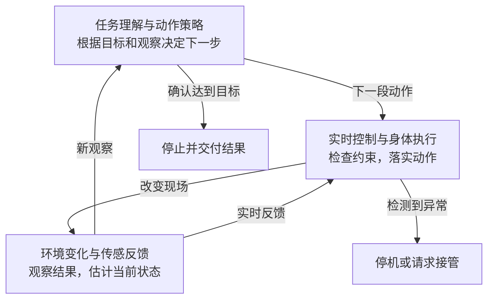

# 从机械臂到机器人基础模型：具身智能的发展脉络

回望过去，人们记住机器人的方式，往往是一幅具体的画面：工厂里的机械臂重复搬运零件，白色的 ASIMO 迈着小步走上舞台，机械手在掌中转动魔方，人形机器人走进厨房，收拾餐具。每一次展示，都让“机器替人做事”更接近眼前的生活。

但这些画面背后的进步并不相同。有时，突破来自更好的电机、传感器和控制；有时，来自机器人在模拟世界里的反复练习；近几年，语言、视觉和动作开始进入同一套学习系统，机器人也开始尝试理解更宽泛的要求。

在[大模型走向 Agent 的历史](/writing/llm-to-agent-evolution/)里，任务从对话框延伸到浏览器、终端与外部工具。到了具身智能，执行环境又多了一层约束：物体有重量，接触会滑动，身体需要保持平衡。一句“把杯子收起来”，必须落到视线、位置、轨迹、力度，以及一次次行动后的重新观察上。

沿着这段历史看下去，会发现一个反复出现的问题：**机器人怎样把在已有环境里学会的本领，带到稍有不同、甚至从未见过的现场？** 这也是从专用自动化走向更通用具身智能的主线。

> 本文以 1961 年工业机器人的应用为观察起点，选取截至 2026 年 9 月可核实的代表性事件。这不是具身思想的诞生时间，也不是完整的机器人编年史。日期分别采用实际事件、官方发布或论文首次公开时间；研究演示、企业披露与实际部署会在正文中区分。

## 阅读导览

本文所说的具身智能，关注智能系统怎样通过身体感知环境、采取行动，并利用反馈调整行为。机械臂、轮式机器人、四足机器人与人形机器人，都可能成为这种系统的载体；身体长得像人，并不自动意味着它能理解任务或自主工作。

也因此，不能把整段发展简单画成“传统机器人被大模型替代”。感知、定位、规划、控制和学习一直在交错前进。今天的机器人基础模型，仍然需要与具体身体及运行系统配合。

| 时期 | 可以记住的事件 | 当时向前走了一步的地方 |
| --- | --- | --- |
| 1961—2005 | Unimate、Shakey、ASIMO、DARPA 挑战赛 | 从固定工位的动作，走向感知环境、规划路线与保持身体稳定。 |
| 2015—2021 | 视觉运动学习、仿真迁移、机械手转魔方 | 动作可以从经验中学习，训练与部署之间的环境差异成为核心难题。 |
| 2022—2023 | SayCan、RT-1、Diffusion Policy、RT-2 | 语言开始选择技能、参与动作生成，示范数据与策略模型共同扩展。 |
| 2024 | Octo、OpenVLA、Digit 部署、π₀ | 可复用的机器人模型与数据逐渐形成，长期运行开始有具体现场。 |
| 2025 | Helix、Gemini Robotics、GR00T、AgiBot World | 数据、模型与身体协同扩展，陌生环境和执行经验成为新的研究重点。 |
| 2026 | 全身控制与跨家庭评测 | 从分开的走路和抓取，进一步走向连续操作；泛化需要更清楚的验证。 |

下面的横轴选取十二个入口。节点按时间顺序等距排列，间距不代表持续时长；点击可以进入正文。

```timeline
{
  "title": "从重复动作，到适应新的现场",
  "description": "1961—2026 · 十二个代表性里程碑；节点等距，点击进入正文。",
  "events": [
    { "date": "1961", "title": "Unimate 进入工厂", "description": "在受控工位里可靠重复动作", "href": "#milestone-unimate" },
    { "date": "1966—1972", "title": "Shakey 边看边规划", "description": "感知、世界表示与行动开始连接", "href": "#milestone-shakey" },
    { "date": "1986", "title": "Brooks 的行为架构", "description": "让机器人直接对环境作出反应", "href": "#milestone-brooks" },
    { "date": "2005", "title": "Stanley 驶过沙漠", "description": "把感知、定位、规划与控制整合起来", "href": "#milestone-stanley" },
    { "date": "2015", "title": "从图像学习动作", "description": "视觉与运动策略联合训练", "href": "#milestone-visuomotor" },
    { "date": "2019", "title": "机械手转动魔方", "description": "在仿真里学习，再应对真实接触", "href": "#milestone-dactyl" },
    { "date": "2022", "title": "SayCan 与 RT-1", "description": "语言任务接上技能与动作策略", "href": "#milestone-saycan" },
    { "date": "2023", "title": "RT-2 与跨机器人数据", "description": "视觉语言知识开始迁移到动作", "href": "#milestone-rt2" },
    { "date": "2024", "title": "机器人基础模型涌现", "description": "共享预训练，再适配任务与身体", "href": "#milestone-octo" },
    { "date": "2025.03", "title": "Gemini Robotics 与 GR00T", "description": "空间理解、动作生成与数据设施并进", "href": "#milestone-gemini" },
    { "date": "2025.11", "title": "π*₀.₆ 从执行中学习", "description": "示范之外，失败与纠正也成为训练经验", "href": "#milestone-pistar06" },
    { "date": "2026", "title": "全身操作与跨环境验证", "description": "把走路、平衡、触觉和操作接起来", "href": "#milestone-helix02" }
  ]
}
```

文中的“收杯子”等简化场景用于解释机制，不是本文开展的实验。涉及成功率、任务表现与部署状态时，以相应论文或机构的公开口径为限。

## 1961—2005｜先让机器在物理世界里行动

在大模型出现以前，机器人已经走过很长一段路。这一阶段留下的几种思路，今天仍然能认出来：把环境安排得足够规整，让动作可靠重复；先建立环境表示，再规划行动；或者让感知直接触发行为，及时应对眼前的变化。

<div id="milestone-unimate"></div>

### 1961｜Unimate：从危险、重复的工位开始

1961 年，Unimate 进入通用汽车工厂，搬运高温压铸件。它的工作具体而有限：按照预先记录的指令，把机械臂移到相应位置，完成抓取、搬运和堆放。

这条路线抓住了工业自动化的重要条件。工件、位置和流程可以预先安排，机器就能把一种动作反复做好，把人从危险工位上解放出来。它不需要先弄懂整座工厂，更不需要理解人的自然语言。

不过，可靠性也依赖这些被安排好的条件。换一种工件、改变摆放方式，系统往往要重新设计或编程。从这里出发，机器人面前逐渐出现一个更难的问题：如果环境不能事先整理好，它该怎样行动？

**来源：** [计算机历史博物馆：1961 年与 Unimate](https://www.computerhistory.org/timeline/1961/)

<div id="milestone-shakey"></div>

### 1966—1972｜Shakey：把“去做一件事”拆成行动

SRI 的 Shakey 像一座装在轮子上的小塔。摄像机与其他传感器让它观察房间，计算机则把环境表示成可以推理的对象与关系，再规划移动和推物体的步骤。

研究环境里的房间、门和箱体经过简化，但问题已经很接近后来 Agent 的基本结构：接收一个目标，判断当前状态，选择动作，观察执行结果。Shakey 还包含执行监控与错误恢复，并不是只在纸上算出一条路线。

困难在于，现实世界很难始终被准确地写进符号模型。物体的形状、光照、位置和接触不断变化；表示一旦偏离现场，再合理的计划也可能失效。接下来，一些研究者开始追问：行动是否每次都必须等待完整的世界模型？

**来源：** [SRI：Shakey 项目回顾](https://www.sri.com/case-study/the-man-the-myth-the-legend-meet-shakey-the-robot-the-worlds-first-ai-based-robot/)、[SRI 汇编的项目技术报告](https://www.sri.com/wp-content/uploads/2021/12/629.pdf)

<div id="milestone-brooks"></div>

### 1986｜Brooks：先对眼前的世界作出反应

1986 年，Rodney Brooks 发表移动机器人的分层控制架构论文，后来常被称为 subsumption architecture。避障、游走等行为可以并行运行，高层能够抑制低层的输出，新增能力时也不必停掉已有的底层行为。

用一个简化场景理解：机器人发现前面有障碍，避障行为先发挥作用，不必等一份完整地图和长程计划全部算完。这让感知与行动之间的联系变得更直接，也让“身体怎样与环境相处”进入架构本身。

这种方法并没有顺带解决语言理解或复杂任务推理。它留下的启发是，智能系统需要处理不同时间尺度的问题：有些决定可以慢慢想，有些反应必须立即发生。后来带着大模型的机器人，同样绕不过这一区别。

**来源：** [Brooks，A Robust Layered Control System for a Mobile Robot](https://doi.org/10.1109/JRA.1986.1087032)

### 2000.11｜ASIMO：拥有一副能走进人类空间的身体

2000 年 11 月 20 日，本田公布 ASIMO。小巧的人形身体、自然一些的步态与转向，让机器人进入日常生活的想象变得鲜明。

背后是长期的机械与控制积累。ASIMO 在原有步行控制上加入对下一步运动的预测，提前调整重心，使连续转向更平顺。这里的“预测”围绕身体运动展开，不能按今天的语境理解成语言模型推理。

当年的发布资料也明确保留工作站和便携控制器。能在人的空间里行走，证明了一部分身体能力；至于看懂房间、接受开放任务并独立做完，则仍是其他问题。人形外观、运动能力与任务自主性，从一开始就不是同一把尺子。

**来源：** [Honda：ASIMO 首次发布](https://global.honda/en/newsroom/news/2000/c001120b-eng.html)

<div id="milestone-stanley"></div>

### 2004—2005｜DARPA 挑战赛：让整套系统经受长距离考验

2004 年的 DARPA 沙漠挑战赛，没有一支队伍完成全程。到 2005 年 10 月 8 日，Stanford 的 Stanley 获胜，五支队伍完成了比赛。短短两届赛事，把自主系统从局部演示推向了持续运行的公开考验。

Stanley 的进步来自整套系统配合：定位和状态估计、激光与视觉感知、路径规划、车辆控制。其中，近处激光判断出的可通行区域，还能为远处道路的视觉判断提供在线监督。

这不是一个神经网络包办所有环节的故事。它说明，学习方法可以进入关键模块，而系统可靠性仍取决于模块怎样连接、怎样处理不确定性。沙漠赛道的成功也没有直接解决城市交通中的所有情况；实验边界之外，还有新的现场。

**来源：** [DARPA：Grand Challenge](https://www.darpa.mil/about/innovation-timeline/grand-challenge)、[Stanley 系统论文，2006 年发表](https://robots.stanford.edu/papers/thrun.stanley05.pdf)

## 2015—2021｜学习深入视觉与复杂动作

机器人学习已有长期积累，深度学习在这一阶段把视觉与复杂动作更紧密地连接起来。示范、尝试和模拟中的经验，能够进一步用于训练策略。问题也随之变化——什么经验值得学，能在哪里获得，离开训练环境以后还剩下多少能力？

<div id="milestone-visuomotor"></div>

### 2015.04｜深度视觉运动学习：看见什么，与怎样动一起训练

2015 年首次公开、2016 年正式发表的一项研究，把相机图像与关节状态连接到动作控制，联合训练视觉运动策略。机器人不再只依赖人手写好的视觉特征，再把识别结果交给一套完全分开的动作规则。

研究采用引导式策略搜索：先借助轨迹优化获得完成特定任务的经验，再让神经网络学习这些行为。视觉表示因而围绕动作任务形成——对于拧瓶盖这样的实验，图像里的信息最终要帮助手臂做对动作。

这类结果还依赖明确的任务、训练设置和真实机器人交互。它展示了从经验学习感知与控制的可能，却没有消除收集经验的成本。把一种任务学好以后，怎样以可承受的代价学会更多任务，成为接下来的主线。

**来源：** [Levine 等，End-to-End Training of Deep Visuomotor Policies](https://arxiv.org/abs/1504.00702)

### 2017.03｜域随机化：让现实成为训练变化中的一种

在真实机器人上反复试错，耗时，也会磨损硬件。模拟器看起来提供了更便宜的练习场，但模拟图像与真实相机、模拟接触与真实摩擦之间，总有距离。这就是 sim-to-real，也就是从仿真迁移到现实所面对的问题。

2017 年，Tobin 等人的域随机化研究提供了一种直观办法：在训练中不断改变纹理、光照等外观条件，让模型不要过分依赖某一个模拟世界。论文围绕视觉定位并接入抓取，检验这种迁移是否有效。

它不要求每一张合成图像都逼真到难以分辨，而是希望变化足够丰富，真实情况也能落进模型见过的变化范围。这个想法很有影响，但视觉外观可以迁移，并不意味着摩擦、柔性物体和所有接触过程也已经模拟准确。

**来源：** [Tobin 等，Domain Randomization for Transferring Deep Neural Networks from Simulation to the Real World](https://arxiv.org/abs/1703.06907)

<div id="milestone-dactyl"></div>

### 2018—2019｜Dactyl 与魔方：学会操作，还要连续做对

2018 年，OpenAI 的 Dactyl 展示了机械手在掌中调整物体姿态。视觉网络估计物体位置与姿态，控制网络协调手指；在变化的模拟条件中训练，帮助策略适应真实硬件。

2019 年 10 月，这条路线走向更醒目的魔方演示。自动域随机化逐步扩大训练条件范围，机械手要连续完成翻转和转面。这里有一个容易被画面掩盖的分工：**魔方的求解步骤来自现成的 Kociemba 算法，学习系统主要负责把步骤变成物理操作。**

长动作链也暴露出可靠性的代价。官方披露，在约需 26 次转面求解的困难打乱设置下，成功率约为 20%。一次精彩完成证明了新能力，失败比例则说明，从“有时做得到”到“可以放心交付”还有距离。

**来源：** [OpenAI：Learning Dexterity，2018](https://openai.com/index/learning-dexterity/)、[Solving Rubik’s Cube，2019](https://openai.com/index/solving-rubiks-cube/)

### 2021.07｜RMA：走到不同地面上，及时调整身体

如果背上忽然多了负载，或者脚下从硬地变成沙地，机器人原来的动作可能不再合适。2021 年的 RMA 将基础运动策略与适应模块组合起来，通过近期的身体状态和动作历史，推断当前环境对运动的影响。

这套策略在仿真中训练，再部署到宇树 A1 四足机器人。研究检验的是不同地形、载荷等变化下的运动适应，说明学习系统可以在运行中利用反馈调整行为。

部署时，已训练的适应模块根据近期状态与动作推断环境表示，策略据此调整动作；更新的是策略输入，模型参数不在现场持续重训。它帮助机器人更稳地走，却不会因此自动知道“去厨房拿杯子”意味着什么；运动与语义任务仍需要连接。

**来源：** [Kumar 等，RMA: Rapid Motor Adaptation for Legged Robots](https://arxiv.org/abs/2107.04034)

## 2022—2023｜大模型接上身体，动作学习继续前进

机器人已经可以学抓取、学走路，但用户通常不会把需求说成关节角度或电机指令。人会说：“饮料洒了，帮我清理一下。”从这句话到真正动手，中间既有常识与任务理解，也有现场可行性和具体动作。2022 年之后，几条研究路线开始从不同位置缩短这段距离。

<div id="milestone-saycan"></div>

### 2022.04｜SayCan：既要知道该做什么，也要知道能做什么

2022 年 4 月公开的 SayCan，给语言模型配上了机器人已有的技能。语言模型判断某个技能是否有助于完成要求，技能的价值函数则估计在当前状态下能否成功；系统结合两种判断，选择下一步。

在“清理洒出的饮料”这个简化例子里，拿来清洁工具在语义上合理，但工具是否在手边、当前技能能否拿到，是另一道判断。SayCan 的意义，是把语言里的合理建议与身体能够执行的事情联系起来。

技能库仍然划定了行动范围。模型说出一个新动作，并不等于机器人学会它；原系统对失败与环境变化的反馈也有局限。语言帮助组织行为，实际能力还得从机器人自己的经验中来。

**来源：** [SayCan 原论文](https://arxiv.org/abs/2204.01691)、[项目页与后续更新](https://say-can.github.io/)

### 2022.12｜RT-1：让多个任务共享一套动作策略

同年 12 月，RT-1 把视线转向另一层：机器人怎样从大量任务示范中，学到可共享的动作策略？相机图像与语言指令进入 Transformer，模型输出经过离散表示的动作。

此前常见的做法，是围绕一项技能收集数据、训练一个策略。RT-1 尝试让多种操作进入同一模型，使不同任务之间能够共享经验。指令在这里不只是选择技能的标签，也参与对当前观察与动作的建模。

这条路线把机器人学习推向规模化，却没有让数据问题消失。示范覆盖哪些物体、动作和场景，仍然影响能力边界。学过“抓起”和“放下”的组合，并不自动意味着掌握拧紧、切割等新的运动技能。

**来源：** [Google Research：RT-1 发布](https://research.google/blog/rt-1-robotics-transformer-for-real-world-control-at-scale/)、[RT-1 首版论文](https://arxiv.org/html/2212.06817v1)

### 2023.03｜PaLM-E：让模型读到身体的观察

2023 年 3 月 6 日，PaLM-E 论文公开。研究者把图像、连续状态等信息编码后送入语言模型，让现场观察能够参与推理与规划，不必先全部改写成人工设计的文字描述。

如果机器人正在整理积木，模型就有机会根据当前画面与要求，生成接下来应做的步骤。具身信息由此进入了语言模型的上下文，计划可以与观察发生联系。

不过，PaLM-E 本身主要输出文本；机器人演示里的具体操作仍由低层策略执行。读懂观察、写出“把积木移过去”，与让机械臂稳定完成这一步，依然处于不同层次。

**来源：** [PaLM-E 论文](https://arxiv.org/abs/2303.03378)、[作者项目页](https://palm-e.github.io/)

### 2023.03｜Diffusion Policy：一次生成一段连贯动作

第二天首次提交的 Diffusion Policy，把扩散模型用在了动作上。给定观察，模型从噪声出发逐步生成一段动作序列，然后执行其中一部分，再根据新的观察继续规划。

可以用绕过障碍物来理解它想处理的一类困难：左边和右边都可能是有效路线，但把两条路线平均，反而可能撞向中间。动作学习需要表达多种可能，还要保持一段动作内部的连贯性。

扩散策略为这类建模提供了办法，也带来多次去噪计算的成本。它改进的是“怎样生成动作”，不会因为采用了生成模型，就同时获得通用任务规划能力。语言理解与精细控制，仍在沿不同路径前进。

**来源：** [Diffusion Policy 首版论文](https://arxiv.org/html/2303.04137v1)、[作者项目页](https://diffusion-policy.cs.columbia.edu/)

### 2023.04｜ALOHA 与 ACT：示范怎样采，动作怎样学

一个月后，ALOHA 与 ACT 的研究把另一件事摆到了台前：如果采集精细动作的门槛太高，再好的学习方法也很难得到足够经验。

ALOHA 是双臂硬件与遥操作系统，让人通过操纵设备给出示范；ACT 则是学习方法，一次预测一个动作块，减轻逐步预测所积累的偏差。硬件、采集方式与算法一起设计，让插入电池、操作小物件这样的任务更容易进入研究。

ACT 还可以根据新观察预测相互重叠的动作块，对同一时刻的预测做时间集成（temporal ensembling），兼顾反馈与平滑性。一次预测多步，并不意味着必须开环执行完整一段。

这里应当区分两种画面：人正在操纵机器人，是采集示范；模型根据观察自行输出动作，才是自主执行。论文展示的是特定任务经过示范训练后的结果，不能把“少量示范”理解成任何新任务都能马上学会。

**来源：** [Learning Fine-Grained Bimanual Manipulation with Low-Cost Hardware](https://arxiv.org/abs/2304.13705)、[ALOHA 项目页](https://tonyzhaozh.github.io/aloha/)

<div id="milestone-rt2"></div>

### 2023.07｜RT-2：把网络知识迁移到动作选择

2023 年 7 月，RT-2 进一步把动作纳入视觉语言模型的输出。研究者把机器人动作表示成 token，与图文任务共同训练，再把输出解码为机器人可以使用的控制命令。这类模型通常称为 VLA，即视觉—语言—动作模型。

变化在于，网络图文预训练获得的语义知识，开始帮助机器人在新的物体与要求之间建立联系。例如，它可能更好地判断一句话指的是哪个对象，再用已经学过的动作处理它。

**语义迁移并不等于新运动技能凭空出现。** RT-2 论文明确讨论了这一限制：机器人能够执行什么物理技能，仍受动作数据约束；模型的计算与延迟，也限制了控制速度。VLA 接通了一条学习路径，还没有消除身体经验的缺口。

**来源：** [Google DeepMind：RT-2](https://deepmind.google/blog/rt-2-new-model-translates-vision-and-language-into-action/)、[RT-2 首版论文](https://arxiv.org/html/2307.15818v1)

### 2023.10｜Open X-Embodiment：不同机器人的经验能否共享

10 月 3 日，Open X-Embodiment 与 RT-X 项目公布。多个实验室把不同机器人的经历整理为共同的数据格式，并检验：一台机器人能否从其他机器人的经验中受益？

这是机器人领域非常具体的数据难题。相机装在不同位置，机械臂长度不同，夹爪与关节的动作空间也不同。互联网文本可以广泛汇聚，机器人轨迹却不能仅靠把文件放在一起，就被当成完全等价的经验。

RT-X 给出了跨机器人训练能够产生正迁移的实验依据，也让共享预训练更可行。但格式统一没有消除身体差异；开放部分数据和模型，也不意味着所有基础模型与完整训练材料同时开放。

**来源：** [Google DeepMind：跨机器人学习项目发布](https://deepmind.google/blog/scaling-up-learning-across-many-different-robot-types/)、[10 月 13 日首次提交的论文](https://arxiv.org/abs/2310.08864)

## 2024｜从单项研究，走向可复用的模型与真实工位

到了 2024 年，“机器人基础模型”逐渐有了更具体的含义：先从多种经验中获得一个可复用的策略，再适配某种身体和任务。同一时期，以 Digit 为代表的人形机器人，也进入限定物流流程的商业部署。研究能力与工作价值，两条线开始靠得更近。

<div id="milestone-octo"></div>

### 2024.05｜Octo：换一台机器人，能否少从头学一些

5 月公开的 Octo 论文研究通用机器人策略。它利用跨机器人轨迹训练扩散策略，并把新相机输入、新动作空间和新机器人的适配纳入设计；任务既可以通过语言，也可以通过目标图像指定。

对研究者而言，意义在于拥有一个能够继续训练的起点。新任务不必只在一小批本地示范上从零学习，可以先继承已有经验，再针对自己的设备调整。

Octo 在部分测试设置中展示了直接使用的能力；换到新的传感器、身体和任务，仍可能需要适配。怎样保留共享经验，又给新设备留出调整空间，成为基础模型设计的一部分。

**来源：** [Octo 论文](https://arxiv.org/abs/2405.12213)、[作者项目与开放资源](https://octo-models.github.io/)

### 2024.06｜OpenVLA：把 VLA 变成可以继续研究的模型

6 月，OpenVLA 论文公开。它将视觉编码器与语言模型组合成动作策略，在真实机器人示范上训练，并提供模型权重、代码与微调工具。

这让 VLA 的研究入口更具体：团队可以检查输入输出、在自己的数据上继续训练，再观察它对新场景的适应情况。开放资源的价值，在于把一部分结果变成他人能够实际检验的对象。

原版 OpenVLA 只支持单张图像输入，推理吞吐也给高频和双臂灵巧控制带来限制。开放的研究起点，让这些问题能够被更多团队检查和继续改进。

**来源：** [OpenVLA 首版论文](https://arxiv.org/html/2406.09246v1)、[项目页](https://openvla.github.io/)

### 2024.06｜Digit：走进物流工位

6 月 27 日，GXO 与 Agility Robotics 宣布多年机器人服务协议。Digit 在 SPANX 仓储流程里，把周转箱从自主移动机器人转移到输送带。这个节点把人形机器人的价值放到一项具体工作上：接入已有设备，衔接上下游，反复完成搬运。

任务被限制得越清楚，越容易判断价值。箱子从哪里来、搬到哪里、与输送设备如何衔接，都可以被工程化安排。对客户而言，是否稳定完成任务、需要多少人工介入，比机器人外形多像人更直接。

客户公告确认了具体应用，但没有提供完整的工时、干预率与维护成本。特定工位的重复劳动可以先落地，其价值也要在这套流程里继续计量。

**来源：** [GXO：与 Agility Robotics 的商业部署协议](https://gxo.com/news_article/gxo-signs-industry-first-multi-year-agreement-with-agility-robotics/)

### 2024.10｜π₀：让语义知识与连续动作共同工作

10 月 31 日，Physical Intelligence 发布 π₀。预训练的视觉语言模型提供表征与语义基础，动作专家通过流匹配生成连续动作块；多机器人数据与任务后训练，共同支持叠衣服、收拾物品等研究任务。

流匹配可以先理解为：学习从随机噪声出发，连续变换出符合当前观察与要求的动作序列。它与把每个动作维度离散成 token 的路线有所不同，关注连续动作生成及其执行效率。

π₀ 把前几年积累的几条线接在了一起：图文知识、真实示范、多机器人经验、连续动作与专门后训练。作者也保留了边界：复杂任务并非全部可靠，数据如何配比、怎样达到更高成功率，仍需研究。

**来源：** [Physical Intelligence：π₀ 首次发布](https://www.physicalintelligence.company/blog/pi0)、[π₀ 首版论文](https://arxiv.org/html/2410.24164v1)

## 2025｜模型、数据与真实经验一起扩展

这一年，人形机器人和机器人基础模型频繁出现在公众视野。沿技术脉络看，值得关注的并不只是又多了一个名字：怎样让语义推理赶得上身体动作，怎样得到更多高质量经验，怎样走进训练之外的房间，这些问题开始被更直接地摆出来。

### 2025.02｜Helix：理解任务与控制身体采用不同节奏

2 月 20 日，Figure 发布 Helix。较慢的视觉语言处理负责理解场景与要求，较快的动作策略负责上半身控制。公司展示了人形机器人根据语言要求拿取物品，以及两台机器人共同处理物品的场景。

这里又能看见早期机器人架构留下的问题：理解“把东西交给旁边的机器人”可以花一些时间，手指和手臂的调整却需要连续发生。把所有决定都塞进同一个速度的循环，并不合适。

Helix 的训练使用遥操作示范，运行时则由模型根据观察输出动作。数据怎样获得、模型怎样执行，是两个环节；人的经验通过前者进入系统，身体的实时反馈通过后者参与行动。

**来源：** [Figure：Helix 首次发布](https://www.figure.ai/news/helix)

### 2025.03｜AgiBot World：把真机示范组织成规模化资源

3 月 9 日，AgiBot World 论文首次提交。这个由智元与研究团队推进的项目，把机器人硬件、示范采集、人工质检、数据与策略学习联系起来。项目报告了百万级机器人轨迹，并提出利用潜在动作表示的 GO-1 策略。

这里的价值，不只是数字变大。机器人数据需要动作与观察对齐，需要知道任务怎样开始、怎样完成，也需要检查示范质量。采集流程本身，开始成为决定学习效果的重要基础设施。

同时，一条轨迹可能来自人的示范，不能算作机器人独立完成了一次工作。数据规模、任务覆盖、策略成功率，是三个需要分别解释的量。它们有联系，但不能互相替代。

**来源：** [AgiBot World 首版论文](https://arxiv.org/abs/2503.06669v1)、[作者数据与模型仓库](https://github.com/OpenDriveLab/AgiBot-World)

<div id="milestone-gemini"></div>

### 2025.03｜Gemini Robotics：空间理解与动作模型分开推进

3 月 12 日，Google DeepMind 发布 Gemini Robotics 与 Gemini Robotics-ER。前者是输出机器人动作的 VLA，后者侧重具身推理，包括空间理解以及与现有机器人能力的结合。

这组发布让一件事更清楚：知道物体在哪里、理解物体之间的关系、推理应该怎样处理，与真正生成可执行动作，既相互帮助，也各有评测方式。一个空间问题答对了，不能直接折算成机械臂完成了一次操作。

6 月发布的 On-Device 版本，又把部分重心移向本机运行，减少对网络连接的依赖。这些路线都在扩大可用范围，但模型访问条件、适配所需数据和真实设备约束，仍然影响谁能把它用起来。

**来源：** [Gemini Robotics 首次发布](https://deepmind.google/blog/gemini-robotics-brings-ai-into-the-physical-world/)、[6 月 24 日 On-Device 发布](https://deepmind.google/blog/gemini-robotics-on-device-brings-ai-to-local-robotic-devices/)

### 2025.03｜GR00T N1：模型背后还需要一套训练设施

3 月 18 日，NVIDIA 发布 GR00T N1，将视觉语言处理与连续动作生成结合起来，面向人形机器人学习。联系同年 1 月发布的 Cosmos，可以看到另一条明确的产业路线：真实数据、仿真、合成数据与策略训练一起建设。

世界模型试图学习环境怎样变化，视频生成可以帮助构造更丰富的训练材料。但生成一段看起来合理的抓取视频，与准确模拟接触力、摩擦和柔性物体，是不同的问题。

因而，这类平台的作用应当具体理解：帮助团队生产、处理和使用经验，降低一部分开发门槛。目标机器人仍需要适配与验证，合成数据也需要检查；模型与工具的开放范围，不能仅凭“开放”两个字一概而论。

**来源：** [NVIDIA：GR00T N1 发布](https://nvidianews.nvidia.com/news/nvidia-isaac-gr00t-n1-open-humanoid-robot-foundation-model-simulation-frameworks)、[GR00T N1 论文](https://arxiv.org/abs/2503.14734)、[Cosmos 平台发布](https://nvidianews.nvidia.com/news/nvidia-launches-cosmos-world-foundation-model-platform-to-accelerate-physical-ai-development)

### 2025.04｜π₀.₅：把问题带到陌生住宅里

4 月，π₀.₅ 的研究把跨环境泛化放到了更显眼的位置。训练结合多种机器人经验、语义任务信息与网络数据，作者在包括未见住宅在内的环境中检验整理任务。

回到开篇的杯子：如果位置、柜子与房间布局都变了，机器人能不能沿用已有能力？这比在原来那张桌子上换一个颜色相近的杯子，更接近普通用户对“会收拾”的理解。

共同训练也不只是增加示范数量：语义子任务与底层动作一起进入学习，使“当前该做哪一步”与“这一步怎样动”建立联系。异构数据能否产生泛化，取决于这些信息怎样组合，而不是只看总时长。

不过，“未见”总有具体的数据划分和测试定义。研究中的新住宅，并不代表所有住宅、所有物体和所有要求。这个节点的意义，是泛化开始通过更贴近任务的场景来检验，而不是只看某段动作是否漂亮。

**来源：** [π₀.₅：具有开放环境泛化能力的 VLA](https://arxiv.org/abs/2504.16054)

### 2025.09｜Gemini Robotics 1.5：把多步任务接到行动中

9 月 25 日，Gemini Robotics 1.5 与 ER 1.5 发布。高层系统可以使用工具、查询信息、安排步骤，再与动作模型配合，执行更长的任务。

这让软件 Agent 与具身系统的连接更加明显。比如，机器人处理一项要求，可能先需要知道目标物体属于哪一类，再决定放到哪里，最后才执行抓取和移动。外部信息、任务状态与身体反馈要在同一过程中发挥作用。

这套分工也带来了具体的接口问题：查询结果怎样变成子任务，动作失败怎样反馈给规划层，什么时候需要人介入。推理接口与动作模型的访问范围也有区别，开发者需要分别确认可用条件。

**来源：** [Google DeepMind：Gemini Robotics 1.5](https://deepmind.google/blog/gemini-robotics-15-brings-ai-agents-into-the-physical-world/)

<div id="milestone-pistar06"></div>

### 2025.11｜π*₀.₆：失败与纠正也进入训练

如果训练资料主要是人顺利完成任务的示范，机器人未必学过偏离以后该怎么办。2025 年 11 月，π*₀.₆ 与 RECAP 尝试把自主执行经验、奖励反馈和专家纠正一起用于改进策略。

这条路线先进行离线学习，再围绕具体任务收集机器人经验。对于做咖啡、折衣或装盒这样的实验，成功示范告诉它应该怎样做，执行反馈则帮助发现哪些做法不够稳、哪里需要修正。

RECAP 的一个关键机制是优势条件策略（advantage-conditioned policy）：利用价值与优势估计，区分相对当前预期更好的行为，并据此训练动作策略。失败与纠正因此不只是多添几条示范，而是为策略改进提供有方向的信号；这不等于运行时每一步都更新模型权重。

经验经过采集、纠正、再训练与验收，才能变成下一版策略。对这条路线而言，机器人完成一次工作，既可能交付结果，也可能留下改善后续行为的数据。

**来源：** [Physical Intelligence：π*₀.₆ 与 RECAP](https://www.pi.website/blog/pistar06)、[11 月 18 日首次提交的论文](https://arxiv.org/abs/2511.14759)

## 2026｜从局部技能走向全身操作，再追问泛化

当手臂能抓取、双腿能行走，把两者放在同一个身体里，仍然会出现新的困难。伸手会改变重心，迈步会改变抓取位置，视线可能被手臂挡住。更通用的任务，需要这些能力持续配合，也需要在新的现场经受检验。

<div id="milestone-helix02"></div>

### 2026.01｜Helix 02：走路、平衡与操作成为连续过程

1 月 27 日，Figure 公布 Helix 02，展示约四分钟的连续洗碗机任务。按公司的披露，机器人在这段过程中自主行走、取放餐具并协调身体，没有遥操作和人工介入。

架构里新增的 System 0 处理更快的全身控制，System 1 生成关节目标，System 2 处理较慢的场景理解与任务安排。触觉、掌部相机和本体感觉也进入系统，帮助应对接触与遮挡。

按公司披露，System 1 以200 Hz生成全身关节目标，System 0 以1 kHz处理身体反馈与协调。这些是架构运行频率，不是本文测得的端到端延迟；它们说明上层尚未重新理解场景时，下层仍可以调整身体。

这使“完整身体参与工作”有了更具体的技术内容。但一段连续演示没有给出陌生家庭中的普遍完成率。它证明的是公司展示条件下可以串起这条动作链；走进更多房间以后怎样，仍需另一组证据。

**来源：** [Figure：Helix 02](https://www.figure.ai/news/helix-02)

### 2026.07｜Gemini Robotics 2：继续拓展身体与任务范围

7 月 30 日，Google DeepMind 发布 Gemini Robotics 2，将全身控制、灵巧操作、多机器人协作与新身体适配纳入进一步研究。动作模型、ER 推理模型与 On-Device 版本继续承担不同职责。

从这组发布能看到，机器人基础模型面对的变化不只有“任务更多”，还有“身体变了”。一副双指夹爪与一只多指灵巧手，即使面对同一个物体，也有不同的动作空间、接触方式与控制难度。

官方发布与模型卡仍讨论了速度、多指操作和分布外任务的限制，部分动作能力通过早期合作伙伴提供。模型正在适应更多身体，身体带来的差异也继续推动模型改变。

还要区分产品家族与具体版本：On-Device 2 模型卡的评测主要围绕站立双臂操作，全身移动相关风险不在该评测范围内。不能把家族发布中的全身能力，直接视作每个本机版本都已完成同样验证；新身体适配也可能包含后训练。

**来源：** [Gemini Robotics 2 发布](https://deepmind.google/blog/gemini-robotics-2-brings-whole-body-intelligence-to-robots/)、[On-Device 2 模型卡](https://deepmind.google/models/model-cards/gemini-robotics-on-device-2/)

### 2026.09｜Helix 2.5：换一个家，究竟还能做多少

9 月 17 日，Figure 发布 Helix 2.5，把评测带到 30 个未见家庭，测试整理客厅、折毛巾和铺床。Index 人类行为数据用于预训练，三类任务再分别使用别处采集的数据微调。

这里的 zero-shot，特指测试家庭与操作物体未用于相应任务适配。每项任务在所有测试家庭使用同一个固定检查点，现场不调整权重，也不根据测试结果挑选检查点。

公司报告，在其对照实验中，预训练将整任务成功率从 9% 提高到 56%；需要安全人工介入的尝试记为失败。这些仍是厂商自报告结果，但问题已经变得更可检验：训练过什么，现场换了什么，怎样算做完，失败有没有算进去。

**来源：** [Figure：Helix 2.5 发布与评测附录](https://www.figure.ai/news/helix-2-5-zero-shot-30-home-generalization)

## 这些路线怎样汇合

把时间轴收起来，再回到“把杯子收起来”这句话，今天一套具身系统所面对的事情就更清楚了：它需要理解要求，观察杯子与柜子的位置，结合身体状态选择动作，控制接触与移动，然后确认杯子确实放好了。

下面是理解这些职责的一种简化方式。实际系统可能把多个环节合在一个模型里，也可能采用多个模型与传统控制器；这不是任何一家厂商的完整实现图。



任务理解决定接下来做什么，动作策略给出一段行为，实时控制负责把它落实到具体身体。传感器持续提供反馈，其中一部分直接进入更快的控制回路；任务是否完成，则还要根据实际环境判断。模型输出、身体执行与结果验收，不能省略其中任何一环。

沿着三十个节点回望，可以辨认出三种逐渐扩大、又始终受条件约束的能力。

**第一，能复用的经验越来越多。** 早期在固定工位上编好的动作，逐步扩展为可以从示范、模拟、多机器人数据和人类行为中学习的策略。基础模型的吸引力，就在于每一次适配新任务时，能够少从头开始一些。

**第二，用户要求与身体动作之间的距离在缩短。** SayCan 用语言选择技能，PaLM-E 把观察带入规划，RT-2 把动作纳入模型输出，后来的 VLA 又探索连续动作与分层运行。它们改进了不同接口，不能只用“给机器人装上大模型”一句话概括。

**第三，能力的考题正在从单个动作变成完整工作。** 连续操作、陌生住宅、具体物流工位，让失败恢复、人工接管、耗时与运行成本越来越难被演示画面遮住。机器人能做什么，最终要回到现场来回答。

### 下一次看到机器人演示，可以多看四件事

| 想判断的问题 | 需要看到的证据 |
| --- | --- |
| 它是否自主完成？ | 区分训练时的人类示范与运行时的遥操作；说明接管、复位和失败如何记录。 |
| 它能否适应变化？ | 分别说明新物体、新布局、新任务与新身体；列清训练和测试的划分。 |
| 它能否连续工作？ | 看完整任务、重复尝试、失败恢复和干预情况，而不仅是成功片段。 |
| 它是否值得部署？ | 在具体流程里衡量完成质量、工时、人工负担、维护与总成本。 |

这些问题也解释了为什么不同成果不能简单排成一张通用榜单。舞台上的平衡能力、实验室里的抓取成功率、仓库累计搬运次数，分别回答不同的问题。把条件讲清楚，才能看见每一次进步真正增加了什么。

回望这六十余年，令人感兴趣的，是机器人获得经验和使用经验的方式不断变化。它们从人事先安排好的动作，走向根据观察选择行动，再走向从许多身体与任务中学习可复用的本领。

接下来的考题仍然具体：换一只杯子、换一间屋子、遇到一次没练过的失手，系统还能不能继续把事情做好。具身智能的发展，最终会体现在这些普通而重复的时刻里。
