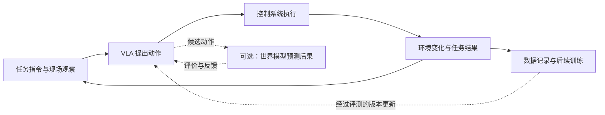

# 从 VLA 到工业交付：智平方、PI、Figure 与原力灵机

一台机器人从货箱中取出商品、放入订单箱，背后需要模型理解、身体执行、失败恢复和质量验收。四家公司的不同选择，最终都会汇到同一个问题：**谁能把真实世界的操作经验，持续转化为可复制、成本成立的机器人能力？**

本文沿“任务 → 技术 → 数据 → 公司 → 工业验收 → 对标策略”展开。以原力灵机为基准，智平方用于对照制造业工位与交付，Physical Intelligence（PI）用于对照跨本体学习与后训练，Figure 用于对照模型、本体、制造和现场工程的协同。

**事实基准为 2026 年 9 月 24 日。** 公司自报实验、客户确认和本文判断分别表述。研究版本、开源版本与现场部署版本分开比较；这里讨论的工业成熟度，不由一次演示或一项榜单认定。

## 一、从一个任务开始：机器人真正需要解决什么？

### 1.1 “把商品放进箱子”为什么复杂？

假设机器人收到指令：“把右侧货箱里的蓝色洗发水放入订单箱，瓶口朝上。”

对人而言，这是一个熟悉动作。对机器人而言，它至少包含六项不同能力。

| 环节 | 机器人需要解决的问题 | 可能出现的失败 |
|---|---|---|
| 看见 | 找到货箱、商品和订单箱 | 反光、遮挡、相似包装导致识别错误 |
| 理解 | 确定“右侧”“蓝色”“瓶口朝上”的含义 | 选对商品，却忽略摆放约束 |
| 规划 | 决定从哪里接近、抓哪里、如何避障 | 路径碰到箱沿或其他商品 |
| 执行 | 控制关节、夹爪和抓握力度 | 商品滑落、夹持不稳或包装受损 |
| 纠错 | 判断失败后是重试、换抓法还是求助 | 重复无效动作，持续占用工位 |
| 验收 | 确认数量、位置、方向与商品质量 | 动作结束了，但订单并未正确完成 |

这些环节共同决定交付质量。机器人可能看懂了指令，却抓不稳；也可能抓得很稳，却放错箱子。因此，竞品分析需要覆盖理解、操作、恢复和任务结果。

### 1.2 从“能做一次”到“可以上产线”，还要经过三道关

第一道是**变化**：包装换了、灯光变了、货箱更拥挤，机器人还能完成任务吗？

第二道是**连续运行**：运行一整班后，电池、温度、传感器、夹爪和网络状态是否仍然稳定？

第三道是**经济性**：把人工接管、现场维护和部署调试都算进去，完成一件合格作业的成本是否有竞争力？

这给出了本文的分析起点：**具身智能公司的价值，取决于它能在多少变化下，以多低的人工依赖和总成本，持续完成合格任务。**

## 二、理解技术：VLA、世界模型和控制系统分别做什么？

### 2.1 VLA：把“看见与理解”连接到“行动”

VLA 是 Vision-Language-Action，即视觉—语言—动作模型。它接收视觉观察、任务指令，以及关节位置等机器人自身状态，生成机器人可以执行的动作。

在前面的例子中，输入可以理解为：“当前货箱图像＋把蓝色洗发水放进订单箱的指令＋机械臂当前位置”；输出则是一段接近、抓取、抬升和放置的动作。

VLA 的意义在于，物体、语言和动作可以通过学习建立联系。RT-2 展示了将动作编码成 token、与视觉语言任务共同训练的做法；PI 的 π0 则采用视觉语言主干与连续动作专家结合的路线。[RT-2 原始研究](https://robotics-transformer2.github.io/)、[π0 技术说明](https://www.physicalintelligence.company/blog/pi0)

这里的“动作专家”，可以理解为专门生成机器人动作的模型模块。它负责将上层理解转化为连续、可执行的控制目标。扩散和 Flow Matching 是生成连续动作的常见方法；阅读竞品报告时，首先需要理解它们服务于动作生成，不必一开始就深入数学推导。

### 2.2 世界模型：学习环境会怎样变化

世界模型学习环境的状态及其变化规律。面向机器人控制时，一个重要方向是预测：在当前状态执行某个动作，会产生什么后果。

例如，同样面对洗发水瓶，夹爪从不同位置接近，可能分别导致成功抓取、推倒瓶子或卡在箱沿。若模型能够预测这些差异，就可能用于筛选动作、构造训练样本，或提供低成本试错环境。

不过，实际研究中“世界模型”覆盖多种用法，分析时应按功能区分。

| 使用方式 | 通俗理解 | 对机器人有什么帮助 | 本文中的对应例子 |
|---|---|---|---|
| 视频表征增强 | 从连续画面中提取物体结构与运动信息 | 改善感知和动作学习 | 智平方参与的 Video2Act 研究 |
| 视觉子目标生成 | 生成“完成下一步后，场景应是什么样” | 帮助策略理解预期状态 | PI π0.7 的视觉子目标 |
| 动作条件预测 | 给定动作，预测它造成的后续变化 | 支撑候选动作评价、策略训练和失败分析 | 原力灵机 DW0.5 的公开设计 |

第一类属于利用视频模型知识，不能仅据此认定系统具备动作条件仿真能力。第二类强调目标状态，第三类进一步强调动作与后果的对应关系。它们可以互补，也需要不同的评测方法。[Video2Act 论文](https://arxiv.org/html/2512.03044v3)、[π0.7 论文](https://www.pi.website/download/pi07.pdf)、[DW0.5 技术说明](https://huggingface.co/blog/Dexmal/dw05)

### 2.3 控制系统：让模型提出的动作稳定执行

高层模型可以决定“抓取洗发水”，但实际执行还涉及关节运动、接触反馈、姿态稳定和异常停止。

这就是快慢系统或分层架构的作用：较慢的模块处理任务理解与规划，较快的模块生成或修正动作，更底层的控制持续接收传感反馈。Figure Helix 02 的公开方案进一步将高层理解、动作生成和全身控制组织起来。[Helix 02 官方说明](https://www.figure.ai/news/helix-02)

因此，“模型每秒推理多少次”“控制器每秒更新多少次”“每小时处理多少件商品”是三个不同指标。它们之间的关系，需要结合动作块、观测频率、执行延迟和任务复杂度解释。

### 2.4 一个完整系统如何协作？

下面是一个用于理解的系统示意，并非声称四家公司采用完全相同的实现。

这张图揭示了两个不同的“闭环”：机器人根据新观察调整行为，是**执行闭环**；收集运行数据、训练新模型、验证后再更新，是**学习闭环**。机器人能够闭环控制，并不自动意味着它已经形成持续学习的数据飞轮。

## 三、理解数据：为什么要有数据金字塔和数据飞轮？

### 3.1 机器人在不同阶段学习不同东西

为了看懂各家公司的技术发布，可以先掌握四个概念。

| 概念 | 它解决的问题 | 用洗发水拣选举例 |
|---|---|---|
| 预训练 | 从广泛数据中学习基础能力 | 认识物体、空间关系和多种抓取经验 |
| 模仿学习 | 从示范中学习怎样行动 | 学习人工遥操作时的接近和抓取动作 |
| 微调／后训练 | 将基础能力适配或优化到目标任务 | 学会特定货箱、夹爪和摆放要求 |
| 强化学习 | 根据任务结果或价值信号改善策略 | 在限定条件下比较动作，优化成功率或速度 |

这些概念存在包含和交叉关系。模仿学习可以用于预训练，也可以用于后训练；后训练可以包含监督微调和强化学习。实际系统还可能使用人工纠正、质量标签或模型生成的反馈，不能简单理解成“机器人完全无人指导地试错”。PI 的 RECAP 就利用了示范、自主执行、人工纠正及结果反馈。[RECAP 原始论文](https://www.pi.website/download/pistar06.pdf)

### 3.2 数据金字塔：先学广泛知识，再补足可执行经验

常见的数据路线包含互联网与人类数据、仿真及合成数据、真实机器人数据。它们在规模、成本、动作标签和任务相关性上存在差异。NVIDIA 的机器人研究也强调这些数据来源的互补。[NVIDIA GR00T 数据路线](https://developer.nvidia.com/isaac/gr00t)

为了分析工业竞争，本文将它细分为下面五层。**这是一种按学习用途组织的分析框架，不是行业统一标准，也不表示各层拥有固定比例。**

| 层级 | 数据是什么 | 主要教会机器人什么 | 对应拣选例子 |
|---|---|---|---|
| 基础层：互联网图像、视频和语言 | 广泛的视觉语义资料 | 物体识别、指令理解、场景常识 | 分辨洗发水、订单箱和方向要求 |
| 交互层：人类操作 | 第一视角视频、手部运动、人—物交互 | 操作顺序、工具使用和多样化行为 | 观察人如何从拥挤货箱取出瓶子 |
| 扩展层：仿真与合成 | 仿真轨迹、场景扰动、生成的未来状态 | 扩展环境与动作组合 | 改变瓶子位置、箱子尺寸和光照 |
| 动作层：真机示范与自主执行 | 图像、状态、动作及任务结果 | 将感知与真实可执行动作对齐 | 用指定机械臂和夹爪完成抓取 |
| 反馈层：生产异常与纠正 | 失败、接管、重试、恢复和质检 | 改善实际业务中的薄弱环节 | 处理滑落、卡箱、错放和重复失败 |

底层数据具有广覆盖价值，上层数据更直接对应目标工位。人类视频可能告诉模型“怎样完成某类操作”，但未必包含该机器人需要的关节指令和接触力；仿真可以扩充变化，但需要检验与真实接触、材质和形变之间的差异。

反馈层也会反过来帮助基础能力。例如，真实失败可以校准世界模型，再由世界模型扩展训练条件。因此，这座金字塔应理解为互相补充的数据结构。

### 3.3 数据多，为什么仍可能学不好？

关键在于数据是否提供了有效、正确且可利用的学习信号。

一段夹爪没有抓到瓶子的视频，如果没有动作和结果标注，模型可能无法判断失败原因；一万次几乎完全相同的成功抓取，也可能无法帮助它处理第一次出现的软包装。

评估数据资产，至少要同时看四点：**有效数量、变化覆盖、标注质量和实际训练收益。** 不同来源的数据小时数，不能直接当作同一种资产相加。失败轨迹也应根据用途处理：可以用于学习动作后果、价值评估和恢复策略，但不应无差别地当作正确示范模仿。

### 3.4 数据飞轮：把现场问题转化为下一轮能力

可以用同一个案例理解完整过程：

1. 机器人在某类软包装上频繁滑落，系统记录失败、状态与动作。
2. 团队确认问题来自夹持策略，补充人工纠正并整理有效样本。
3. 模型通过后训练改进抓法，必要时用世界模型扩展相关条件。
4. 在独立物料和工位上测试，确认成功率改善且旧任务没有退化。
5. 小范围上线后，测量人工接管、节拍和破损情况。
6. 当收益成立，再推广至更多同类工位，继续收集新的薄弱环节。

这里的数据飞轮成立，需要有一个可观察的结果：**新增经验让下一批任务更容易、更稳定或更便宜地完成。** 仅有设备联网、视频上传或部署数量增长，都不足以证明这一点。

商业飞轮与之相连：机器人产生收益，客户愿意继续使用和扩点，企业获得更多真实任务与反馈，再用这些经验改善产品。要完成这个循环，还需要客户数据授权、稳定的日志接口、质量判断和版本管理。

## 四、进入公司比较：四家公司分别选择了什么路线？

### 4.1 先看它们希望在产业链中占据什么位置

机器人业务可以粗略分成三层：提供智能的软件与模型、承载操作的机器人本体、把机器人接入生产的行业方案与服务。不同公司覆盖的层次有所重叠，但经营重点和竞争压力不同。

| 公司 | 路线概括 | 核心竞争命题 | 需要承担的主要挑战 |
|---|---|---|---|
| 智平方 | 模型、整机与制造业方案共同推进 | 能否把机器人有效嵌入工艺，并复制到更多工位 | 多行业项目的适配、验收和交付成本 |
| PI | 面向不同机器人及应用商的智能层 | 一套学习体系能否跨本体、跨任务复用 | 适配多种硬件，以及依赖伙伴获得现场反馈 |
| Figure | 人形本体、模型、数据与制造整合 | 能否用系统协同实现可靠的全身操作 | 硬件、制造、维护和大规模研发投入 |
| 原力灵机 | 开放模型及工具链，结合仓储场景网络 | 能否将仓储经验转为可扩展的模型与交付能力 | 打通既有业务、有效数据和模型收益之间的链路 |

这些是基于公开产品与合作信息作出的路线归纳，不代表各公司收入已按这些类别得到验证。尤其是模型订阅、整机销售、集成和运营服务的收入比例，本文所用公开资料不足以统一比较。[智平方介绍](https://ai2robotics.com/en/about/)、[PI 合作说明](https://www.pi.website/blog/partner)、[Figure 03 介绍](https://www.figure.ai/news/introducing-figure-03)、[原力聚合合并公告](https://www.atomixrobot.com.cn/news/228.html)

### 4.2 智平方：重点看模型如何进入制造业工位

**它提供什么？**

智平方是 AI² Robotics。其公开产品组合包括 AlphaBrain／GOVLA 具身智能模型和 AlphaBot 机器人系列，以整机和场景方案推进应用。其轮式双臂设计，为平整地面上的移动操作提供了一种实现方式。[智平方官方介绍](https://ai2robotics.com/en/about/)

**技术重点在哪里？**

可以用三个实际问题理解其研究布局。

| 实际问题 | 对应研究 | 应理解成什么能力 |
|---|---|---|
| 上层理解较慢，动作需要连续 | FiS-VLA | 通过异步快慢系统协调理解与执行 |
| 单张图片不足以表达运动过程 | Video2Act | 从视频模型提取空间和运动表征，辅助动作学习 |
| 接触变化需要及时反馈 | NeuroVLA | 探索规划、高频反馈和快速执行的分层机制 |

这三项研究分别涉及执行效率、时序感知和反馈响应。论文实验能够证明方法在特定设置下的效果，商业交付时仍要核对具体模型、控制系统与本体配置。[FiS-VLA 论文](https://papers.neurips.cc/paper_files/paper/2025/hash/8cf3760422b9d4505589a97c8f9569e7-Abstract-Conference.html)、[Video2Act 论文](https://arxiv.org/html/2512.03044v3)、[NeuroVLA 论文](https://arxiv.org/abs/2601.14628)

**数据从哪里来，可能形成什么优势？**

东风柳汽客户官网介绍了智平方线上数据、仿真、世界模型合成和真实采集的多源数据路线，并确认双方合作涉及制造场景及语料中心建设。这意味着它有机会从真实工艺中获得稳定、重复出现的操作与异常反馈。[东风柳汽客户披露](https://www.dflzm.com.cn/index.php/news/newsinfo/1977/218)

这种路线的潜在优势，是同类工位能重复使用相近技能：先解决一种零件的上下料，再迁移到相似工件和设备。其成立条件是模型、末端工具和现场接口有足够共性，新增客户不需要重新开发整套系统。

**工业落地已经证明到哪里？**

东风柳汽资料确认了合作与场景建设方向，未在该文中给出完整的运行台数、接管率和长期节拍。惠科相关合作的公开口径则是未来三年部署超过一千台，属于需要继续追踪履约的部署计划。[第一财经报道](https://www.yicai.com/brief/102819774.html)

**对原力灵机意味着什么？**

应重点比较双方进入工位、明确验收标准、处理异常和复制交付的能力。对于原力灵机，先把仓储操作做成可复用的作业单元，再扩展到制造工艺，比同时覆盖大量差异很大的场景更容易检验模型与数据的收益。

### 4.3 Physical Intelligence：重点看经验能否跨机器人复用

**它提供什么？**

PI 的公开方向是提供可复用的物理智能层，与本体及应用伙伴合作。由合作伙伴将智能能力接入自己的机器人和客户工作流，是其与整机公司比较时需要考虑的组织差异。[PI 合作说明](https://www.pi.website/blog/partner)

**技术重点在哪里？**

其演进路线可以概括为：从视觉语言知识学习机器人动作，扩展到多场景、多本体经验，再通过后训练利用自主执行与人工纠正，逐步提高泛化和操作质量。

π0.7 的一个重要设计，是给训练数据补充更丰富的条件：任务与子步骤语言、执行速度、质量、控制方式以及视觉子目标。这样，模型能够区分不同执行策略和质量的样本，探索将已有技能重新组合到新任务中。[π0.7 官方说明](https://www.pi.website/blog/pi07)

以拣选为例，“这一段执行较慢但成功”“这一段没有抓稳”“这一次经过人工纠正”是性质不同的经验。PI 的研究启发是：数据平台应保留这些区别，让模型知道它在学习哪一种行为。

**世界模型在其中发挥什么作用？**

π0.7 的公开方案利用世界模型生成视觉子目标，帮助策略理解下一阶段应达到的状态。可以将它理解成给“把瓶口朝上放好”补上一张目标状态图。它与用于预测不同候选动作后果的仿真器存在功能区别，不能直接由目标图生成推断出精确接触预测能力。[π0.7 论文](https://www.pi.website/download/pi07.pdf)

**数据飞轮和现场应用有什么证据？**

PI 与 Weave 的合作报告披露，将客户数据加入预训练后，每批衣物的人工接管次数减少 50%；Ultra 也披露了真实订单包装及人工介入回流机制。这类材料把数据、模型版本和运营变化联系起来，提供了早期现场闭环的证据。[合作伙伴报告](https://www.pi.website/blog/partner)

不过，研究与商业版本需要分开：本研究基准日采用的前沿研究是 π0.7，上述现场报告主要对应 π0.6，openpi 仓库列出的开放模型则包括 π0、π0-FAST 和 π0.5。开源版本便于公平复现，但不能自动代表该公司的最新内部能力。[openpi 仓库](https://github.com/Physical-Intelligence/openpi)

**对原力灵机意味着什么？**

PI 是模型复用能力的重要对标。原力灵机应检验：新增一个工位需要多少专门数据，换一种机器人需要多少适配工作，一家客户的经验能否改善另一家客户。如果通用底座越来越强，场景公司还需要凭借工程交付、数据质量和运营服务保持差异化。

### 4.4 Figure AI：重点看模型与身体怎样共同进步

**它提供什么？**

Figure 将人形机器人本体、模型、数据采集和制造能力结合起来。Figure 03 的公开设计包含掌心视觉、指尖触觉以及面向制造的结构改进，体现出围绕学习与执行需求设计硬件的路线。[Figure 03 官方说明](https://www.figure.ai/news/introducing-figure-03)

**技术重点在哪里？**

Helix 02 将语义理解、动作生成和全身控制结合。对它而言，“取出瓶子”可能不仅需要机械臂移动，还需要调整身体位置、姿态与视角。模型与本体共同设计，有助于协调这些变量，但也会提高系统开发和维护的复杂度。[Helix 02 技术说明](https://www.figure.ai/news/helix-02)

Helix 2.5 则突出人类行为数据的预训练价值。Figure 披露，其基于 Index 预训练后，分别适配整理、叠毛巾和铺床三类行为，在三十个未见家庭测试；其控制变量实验中，完整任务成功率由 9% 提升至 56%。这里的“未见”指测试环境与物体，任务本身仍经过适配。[Helix 2.5 官方实验](https://www.figure.ai/news/helix-2-5-zero-shot-30-home-generalization)

**数据优势可能怎样形成？**

Figure 的 Index 管线用于大规模收集人类行为视频，并进行过滤、去重、重平衡和标注。随后还需要真机数据把这些广泛经验与机器人动作联系起来。其价值应同时看覆盖范围、有效样本质量和对机器人任务的实际增益。[Index 官方说明](https://www.figure.ai/news/introducing-index)

此外，Figure 还有一条工程反馈循环：真实运行暴露硬件故障，推动结构、制造和维护改进，更稳定的机器人再提供更多有效运行与学习机会。公司在 BMW 项目复盘中，明确讨论了前臂问题向 Figure 03 设计的反馈。[BMW 项目复盘](https://www.figure.ai/news/production-at-bmw)

**工业落地已经证明到哪里？**

BMW 客户侧确认，Figure 02 在约十个月试点中累计运行约 1,250 小时，搬运九万余件零部件，支持三万余辆 X3 的生产。这支持限定生产工序的实际应用判断。该结果属于 Figure 02 对应项目，不能直接转移到 Figure 03、Helix 2.5 或家庭任务。[BMW 客户披露](https://www.bmwgroup.com/en/news/general/2026/humanoid-robot-in-leipzig.html)

Figure 还提供了更接近工业指标的数据增益实验：在相同架构和超参数下，物流示范数据从约 10 小时增加到 60 小时，平均单件处理时间由约 6.84 秒降至 4.31 秒，条码朝向成功率由 88.2% 升至 94.4%。这说明该特定任务中，新增数据与节拍、质量改进有关；它不能代表整机在所有工业任务上的可靠性，也不是本文独立复现的结果。[Figure 物流消融实验](https://www.figure.ai/news/scaling-helix-logistics)

BotQ 的规划产能、内部采集机器人的下线数量与外部付费交付，也应分别统计。扩产说明制造投入，客户持续使用才进一步说明产品价值。[Figure 03 生产进展](https://www.figure.ai/news/ramping-figure-03-production)

**对原力灵机意味着什么？**

应学习其通过现场问题决定模型和硬件改进的机制。是否采用双足、轮式或固定双臂，取决于目标工位的空间、移动和操作需求；评估重点应放在增加某项硬件能力后，能否降低失败、维护和单位作业成本。

### 4.5 原力灵机：重点看开放能力怎样连接真实仓储业务

**它提供什么？**

原力灵机公开布局包括 DM 系列动作模型、DW 世界模型以及开发工具链，并通过与原力聚合 Atomix 的合并，获得更直接的仓储业务连接。OpenDM 提供模型权重及训练、推理与评测流程；合并公告则描述了既有仓储客户与业务网络。[OpenDM 仓库](https://github.com/dexmal/opendm)、[合并公告](https://www.atomixrobot.com.cn/news/228.html)

**技术重点在哪里？**

DM0.5 的历史上下文、具身推理和轨迹对齐，可以分别对应三类现场需求：记住已经执行的步骤，理解约束和任务进展，减少不同示教节奏带来的学习噪声。[DM0.5 技术说明](https://huggingface.co/blog/Dexmal/dm05)

DW0.5 的公开设计强调根据动作生成后续轨迹，并通过价值评价服务于策略选择或后训练。其潜在价值是减少昂贵的真机试错，但依赖真实数据校准和失败建模。公开方案描述与已开放范围还要区分：截至上述事实基准日，OpenDW 仓库注明 Value Expert 将在后续版本更新，不能据此声称完整闭环已经全部可复现。[DW0.5 技术说明](https://huggingface.co/blog/Dexmal/dw05)、[OpenDW 仓库](https://github.com/dexmal/opendw)

**数据优势可能怎样形成？**

仓储任务具有持续业务需求，物体、包装和摆放又会发生变化。这可能为模型提供重复出现的操作结构与丰富的异常样本。原力灵机的战略机会，是把这种任务流转成标准化的观测、动作、结果和纠正记录，再让改进后的模型服务更多同类工作。

仓储系统还需要把模型嵌入可继续运行的工作流。Ferrata 的公开报道描述了标准自动化、具身执行和人工接管的分工：可确定的任务由成熟自动化处理，具有变化的操作交给具身策略，异常转人工并留下反馈。这种分工为学习闭环提供入口，实际仓库测试仍应与多客户长期运营区分。[Ferrata 发布报道](https://finance.sina.com.cn/tech/roll/2026-06-17/doc-inicthnr3834391.shtml)

**当前最重要的验证缺口是什么？**

合并公告中的原有客户规模与仓储出货量，能够说明场景基础，但还需要进一步分辨其中有多少任务由新模型执行、产生多少可训练轨迹、带来多少经验证的升级收益。客户入口、可用数据和模型能力之间，仍需要采集、权限、筛选、训练及交付机制连接。[原力聚合业务披露](https://www.atomixrobot.com.cn/news/228.html)

**战略定位应如何表达？**

本文的建议定位是：以仓储高频操作为基础，将开放模型、可复用工具链和世界模型后训练结合，持续降低新工位适配成本及人工依赖。这个定位的价值，最终应由不同客户、物料和设备上的实际复制表现支撑。

## 五、横向比较：真正的差异发生在哪里？

### 5.1 技术层：比较系统职责，而不是只比较模型名称

下表是对前述技术资料的归纳。“尚待验证”指本文所引材料不足以支持相应判断，不代表公司内部没有相关研发。

| 比较维度 | 智平方 | PI | Figure AI | 原力灵机 |
|---|---|---|---|---|
| 主要承载方式 | 模型与 AlphaBot 整机结合 | 适配不同本体和应用伙伴 | 自研人形本体与 Helix 协同 | 跨本体模型、工具链与仓储应用结合 |
| 公开研究重点 | 异步执行、视频表征、高频反馈 | 多源学习、跨本体迁移、混合质量数据与后训练 | 全身控制、人类行为预训练、硬件反馈 | 历史上下文、轨迹对齐、动作条件世界模型 |
| 世界模型相关证据 | 视频表征研究及平台适配，需逐项核对用途 | π0.7 中的视觉子目标生成 | 所引核心资料以行为学习和全身控制为主，显式动作预测闭环尚待验证 | DW0.5 面向动作后果预测与后训练，公开模块仍需核对完整性 |
| 应重点测量 | 任务理解与实时反馈能否改善实际工位表现 | 新任务、新本体的数据与适配成本 | 全身协调和传感设计带来的质量与可靠性收益 | 世界模型及工具链是否减少真机试错与部署工时 |

### 5.2 数据层：比较新增经验带来的收益

| 公司 | 数据路线中的突出环节 | 潜在优势：分析判断 | 必须继续验证 |
|---|---|---|---|
| 智平方 | 多源数据与制造业客户场景 | 同类工艺经验有机会反复使用 | 跨客户、跨工位复用能否抵消项目定制成本 |
| PI | 多本体、人类经验、自主轨迹与伙伴反馈 | 可将不同来源的技能沉淀到通用智能层 | 跨本体增益能否转化为稳定的商业适配效率 |
| Figure | Index 人类数据与自有机器人反馈 | 广覆盖行为知识与软硬件一致性可以相互支持 | 更多人类数据在工业任务上的边际收益与完整成本 |
| 原力灵机 | 多源模型训练与仓储业务入口 | 高重复业务结构有利于建立可测量的学习闭环 | 作业流有多少转为有效训练数据，再改善其他工位 |

这些优势具有条件性。整机路线通常更容易控制传感器和动作接口，但承担更多硬件责任；横向模型路线可以服务多种本体，但适配和数据协议更复杂。跨本体学习仍需要处理坐标、控制频率、末端工具及传感差异，不能将“同一模型”理解成无需硬件适配。

### 5.3 泛化层：把“通用”拆成四个可测试问题

| 泛化类型 | 要回答的问题 | 拣选案例 |
|---|---|---|
| 物体与环境泛化 | 换物体、背景或摆放还能做吗？ | 新包装、反光瓶、拥挤货箱 |
| 任务泛化 | 能执行新的指令、约束或技能组合吗？ | 从单件抓取变成按顺序装箱 |
| 本体泛化 | 经验能否迁移到不同机器人？ | 更换机械臂、夹爪或相机配置 |
| 运行鲁棒性 | 遇到扰动、失误和长时间运行还能持续完成吗？ | 商品滑落后恢复，跨班次稳定作业 |

第四项涉及可靠性和恢复，不能仅由前三项推导。宣称“零样本”时，也应明确到底没有见过物体、场地、任务还是本体，以及是否使用过目标任务的其他环境数据。这样的拆分，才能把营销语言转成可执行的对标实验。

## 六、判断工业成熟度：怎样看懂演示、订单和生产数据？

### 6.1 将技术能力、交付进展与经营结果分开

本文建议按以下证据理解企业进展。这是分析工具，不是统一认证等级。

| 证据类型 | 可以支持什么判断 | 还缺什么 |
|---|---|---|
| 演示视频、论文实验 | 某种能力在指定设置下出现 | 随机任务表现、长期运行与交付成本 |
| 客户合作或部署计划 | 获得场景入口和合作意向 | 实际交付、验收及付费情况 |
| 客户现场试点 | 能在真实流程中承担限定任务 | 多班次可靠性、异常和维护统计 |
| 持续运营及重复扩点 | 具备一定运行与复制能力 | 跨客户收益、完整成本和长期盈利 |
| 经核实的经营结果 | 业务产生收入或利润 | 收入对应的产品范围与持续性 |

公司可能同时处于多个阶段：某款产品已经试点，新模型仍在研究，另一项合作尚在规划。应对具体版本和项目作判断，不宜给整家公司贴一个笼统成熟度标签。

### 6.2 四个容易误读的数字

| 案例 | 正确理解 | 对竞争分析的影响 |
|---|---|---|
| 智平方惠科相关“千台” | 公开口径为未来三年的部署计划 | 可以评价场景拓展潜力，不能据此计算已交付规模或收入 |
| Ultra 的“96.4%” | 完整八小时班次中自主运行时间的占比 | 不能替代任务成功率，也不能直接推算接管频次 |
| Figure 的“支持三万余辆 X3” | Figure 02 在特定工序试点参与生产 | 不能理解成独立造车，或算作新一代模型的成绩 |
| 原力聚合的“日均出货六十万余件” | 合并公告披露的既有仓储业务口径 | 不能直接视为 DM 系列模型的自主操作数量 |

这些口径分别来自[智平方合作报道](https://www.yicai.com/brief/102819774.html)、[Ultra 官方披露](https://www.linkedin.com/posts/ultraroboticsco_weve-been-collaborating-with-physical-intelligence-activity-7432209489723887616-r3e_)、[BMW 客户资料](https://www.bmwgroup.com/en/news/general/2026/humanoid-robot-in-leipzig.html)和[原力聚合公告](https://www.atomixrobot.com.cn/news/228.html)。它们各自有价值，但分母和业务阶段不同，不能直接放在同一张“实力排行榜”上。

### 6.3 工业验收应统一比较什么？

| 验收维度 | 建议指标 | 为什么影响客户决策 |
|---|---|---|
| 完成质量 | 首次成功率、重试后成功率、合格率、损伤率 | 决定是否产生可用产出 |
| 实际产能 | 合格件数／计划生产小时 | 将等待、重试和停机纳入实际表现 |
| 人工依赖 | 每千件接管次数与人工分钟数 | 决定机器人实际节省多少人工 |
| 连续运行 | 可用率、故障间隔与恢复时间 | 决定是否影响生产计划 |
| 适配效率 | 新物料、新工位所需数据和工程工时 | 决定扩点成本及交付速度 |
| 学习收益 | 新增数据后的接管、质量与节拍改善 | 判断数据飞轮是否真正产生效果 |
| 完整经济性 | 单位合格作业成本 | 将技术表现与投资价值连接起来 |

对于世界模型，还要增加四项针对性检验：同一状态下不同动作是否产生不同且合理的预测；能否覆盖失败与恢复；在模型中更优的策略是否在真机上也更优；使用它之后是否减少了达到同等任务表现所需的真实交互。

这些检验应在未参与训练的物料和工位上进行，并保留模型版本、数据截止日期、硬件配置及测试规则。企业自报实验可以作为线索，采购或规模化部署仍需要目标工位验证。

### 6.4 从模型实验到采购决策，还需要一份共同测试协议

同一类拣选任务可以分三层评测：先固定机器人、物料和光照比较基础能力；再用未参与训练的包装、摆放与扰动检验迁移；最后在连续班次中记录等待、重试、接管和维护。每层都保留所有任务尝试，不能只保留成功片段。

比较世界模型时，除真实数据预算一致外，还需记录生成、训练、推理和人工审核的成本。视觉子目标、在线候选动作评分与离线训练环境承担不同职责，不应以相同延迟要求笼统评判。π0.7 的视觉子目标生成与动作执行采用异步组织，也提醒我们：应同时记录模型响应、动作执行和最终节拍。[π0.7 论文](https://www.pi.website/download/pi07.pdf)

验收记录至少包含任务定义、物料范围、模型版本、硬件与末端配置、训练数据截止、允许的重试与人工介入、合格产出和完整成本。同一家公司也可能在不同配置上得到不同结论。

### 6.5 用一个假设算例理解“完整成本”

以下数字只用于解释核算方法，不对应任何公司实际产品。

假设某工位每月的设备折旧、集成摊销、计算、人工接管、维护和报废损失合计为 3 万元，完成 10 万件合格作业，则平均成本为 **0.30 元／件**。

一次模型升级后，月度总成本增至 3.3 万元，但在相同质量要求下完成 15 万件合格作业，平均成本降至 **0.22 元／件**。即使计算开销增加，这次升级仍可能有经济价值。

反过来，机器人动作更快，却带来更多破损、接管或停机，总收益就可能下降。因此，工业竞品分析应把速度、质量、人工和设备成本一起计算；订单回款、合同价格及厂商利润则属于进一步的经营分析。

## 七、落到原力灵机：应该怎样对标，先做什么？

### 7.1 对标目标应分为三组

| 对标对象 | 优先学习的能力 | 原力灵机需要给出的证据 |
|---|---|---|
| 智平方 | 工艺理解、客户验收与行业交付 | 同类工位的上线工时和定制比例随项目积累下降 |
| PI | 跨本体学习、混合质量数据利用与后训练 | 一处客户的经验改善其他客户，新任务需要更少专门数据 |
| Figure | 传感、模型、本体及现场维护协同 | 针对真实故障的系统改进，提高连续运行与合格产出 |

原力灵机应把这三组能力连接到自己的仓储入口：先确定高价值任务，再识别主要失败，再决定用模型、数据、硬件还是流程改进解决。每个技术投入都对应一个能够测量的业务问题。

### 7.2 场景优先级：选择高频、有变化、结果可验证的作业

适合优先检验的任务，应同时满足几个条件：有持续需求，结果可以判断，异常能够恢复，数据可记录，且不同客户之间存在足够共性。

仓储拆零拣选、包装处理与异常重试可以作为候选作业族，但是否进入开发，仍需核算具体物料范围、传统自动化基线和客户要求。高度标准化且成熟自动化已能高效完成的部分，可以保留原有设备；具身策略承担具有变化、需要柔性操作的环节。

选择场景时还要考虑数据的可迁移性。一类任务即使容易收费，如果所得经验只能服务某个专门夹具，其对通用模型的贡献可能有限。相反，跨客户反复出现的抓取、整理、放置和恢复问题，更适合验证能力复用。

### 7.3 数据优先级：建立从失败原因到改进收益的记录

建议以“任务”为基本记录单元，把指令、物料、图像、机器人状态、动作、结果和人工参与关联起来。

失败需要进一步分类：视觉误判、目标理解错误、运动干涉、接触滑移、设备故障和外部流程等待，应采用不同的改进方式。模型训练可以解决其中一部分问题，另一些需要标定、末端工具或生产流程调整。

每次数据回流至少应回答三个问题：这批数据补足了什么变化，改善了什么指标，收益能否迁移到没有采集过的新工位。由此形成的数据目录，比单纯按客户或日期堆放录像更有训练和交付价值。

### 7.4 世界模型优先级：先证明一个明确收益

世界模型可以先围绕一类边界清晰的任务，验证候选动作筛选、失败样本扩展或后训练中的一个用途。

试验应设置对照：相同基础模型、相同真实数据预算与相同验收条件下，使用世界模型后，是否减少了真机试错，或提高了未见物料上的表现。还应记录生成、训练与验证的总开销，防止把真机成本转移为更高的计算和人工审核成本。

当收益得到重复验证，再扩大任务范围。对于接触复杂、材料变化大或失败代价高的作业，真实数据校准与部署前验证尤其重要。

### 7.5 用三个阶段安排落地

以下为建议的推进顺序，不代表公司已有内部计划；时间安排应随客户工位和资源调整。

| 阶段 | 核心工作 | 应交付的结果 | 进入下一阶段的依据 |
|---|---|---|---|
| 建立基线 | 选择任务族，统一日志、失败分类及成本核算 | 可复查的任务边界、测试集和运行指标 | 能准确知道失败在哪里、人工花在哪里 |
| 验证学习闭环 | 筛选失败数据，做后训练与受控上线 | 新旧版本对照，以及旧任务回归结果 | 质量、接管或成本有可重复改善 |
| 验证复制能力 | 扩展新物料、新工位及不同设备 | 适配所需数据、工程工时与运营收益 | 新项目减少定制投入，旧经验仍然有效 |

开放模型与工具链可以帮助这一过程，但需要同时明确客户数据权限、部署反馈接口和合作激励。开发者使用工具、下载模型，与愿意回流生产数据是不同决策，应分别设计机制。

## 八、形成自己的竞品结论

当基础概念、技术职责、数据来源和工业指标被逐层拆开后，四家公司的竞争逻辑就更清楚了：智平方将模型与整机引入制造业场景，PI 探索可跨本体复用的智能层，Figure 将行为学习与人形本体、制造和工程反馈结合，原力灵机则有机会将开放模型及工具链接入仓储高频业务。

对原力灵机最有价值的定位建议是：**从仓储操作中获取可学习的真实经验，用模型与工具链降低适配成本，再通过可验证的运营收益扩大应用。**

判断这条路线是否成立，可以持续追问同一个问题：**今天解决的一次现场问题，明天能否帮助更多设备、更多物料和更多客户，以更低的成本完成合格任务？** 对这个问题的回答，连接了 VLA、世界模型、数据金字塔和工业级竞争力。

## 延伸阅读

[16 家公司竞争格局](/writing/embodied-intelligence-competition/) · [任务经济性](/writing/embodied-intelligence-production/)。
