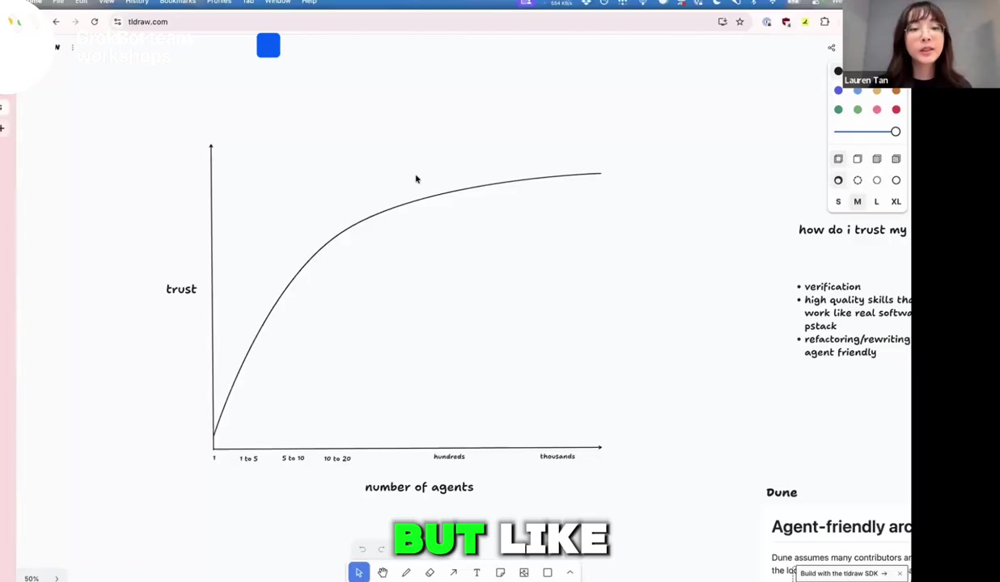
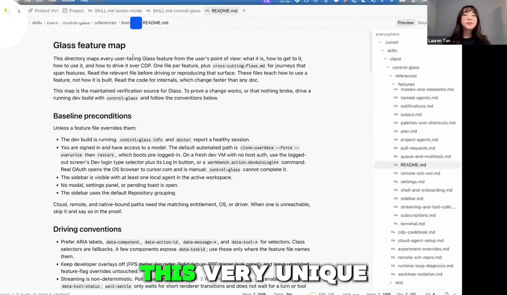
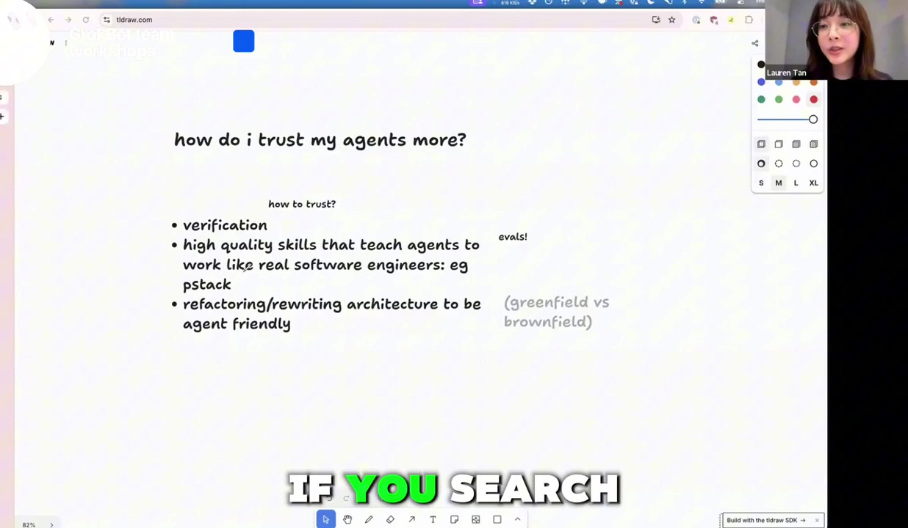
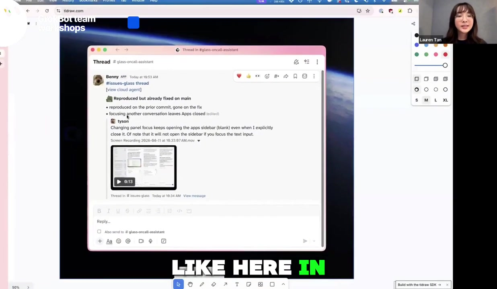
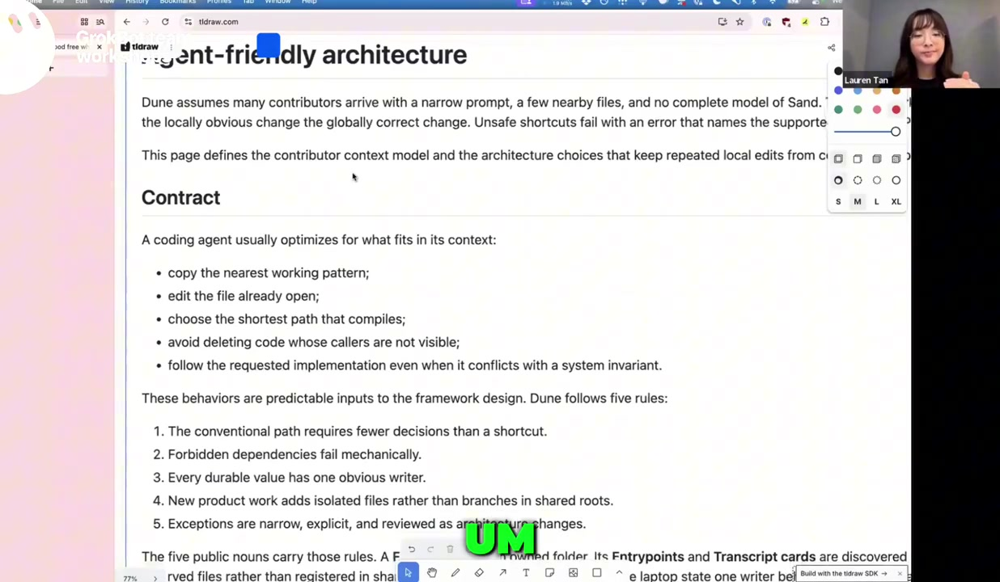

如果一个 Agent 改完代码，还得由你启动应用、点击页面、复制报错，再告诉它哪里错了，那么同时开十个 Agent，往往只是同时产生十份等待你检查的工作。

Lauren Tan 的这场分享从这个瓶颈出发：**怎样让 Agent 自己取得反馈，怎样把工程判断写进工作环境，以及什么时候才适合扩大委派范围。** 她把管理工程师的经验带入 Agent 协作：刚加入项目的成员需要上下文、工具和清楚的标准，Agent 也一样。

本文依据 [YouTube 视频《Lauren Tan XAi Grokbot》](https://www.youtube.com/watch?v=Cmoh-yR-usA)及其自动字幕整理。视频长约 59 分 41 秒，内容对应课程《How Cursor Turned AI Agents Into Better Engineers》。这是按问题重组的中文解读，不是逐字翻译；自动字幕中的产品拼写统一为 Cursor、Grok Bot、pstack。截图来自该视频，图下注明时间并链接回原片；补充的操作建议会明确标注。

先澄清截图传播文案里的数字：本次没有确认“一个人运行 50 多个 Agent”“97% 的工程师采用同样方式”“相当于 20 个工程师”等说法。视频中能定位到的是 Lauren 自述的一晚约 20 个 PR 已合并、单月约 1,000 个 PR，以及为重构投入 600 多个 PR。**PR 是代码变更提案，数量不能直接换算成人数、质量或业务产出。**

| 想了解什么 | 视频位置 | 本文入口 |
| --- | --- | --- |
| 为什么先建立信任 | [03:00](https://www.youtube.com/watch?v=Cmoh-yR-usA&t=180s) | 信任决定委派范围 |
| Agent 如何亲自验证产品 | [07:48](https://www.youtube.com/watch?v=Cmoh-yR-usA&t=468s) | 让 Agent 完成反馈闭环 |
| 怎样找到正确的功能与页面 | [12:14](https://www.youtube.com/watch?v=Cmoh-yR-usA&t=734s) | 功能地图 |
| 技能怎样形成、怎样评测 | [15:42](https://www.youtube.com/watch?v=Cmoh-yR-usA&t=942s) | pstack 与评测 |
| 何时进入云端协作 | [26:24](https://www.youtube.com/watch?v=Cmoh-yR-usA&t=1584s) | 从本地走向云端 |
| 如何用架构限制错误 | [32:09](https://www.youtube.com/watch?v=Cmoh-yR-usA&t=1929s) | Dune 与持续检查 |
| 成本与跨职能协作 | [51:08](https://www.youtube.com/watch?v=Cmoh-yR-usA&t=3068s) | 投入、回报与角色变化 |

## 一、信任决定你能够委派多少工作

Lauren 曾在 Netflix、Meta 工作，也有工程管理经历。她观察到，管理人和管理 Agent 有一个共同问题：如果你不相信对方能够按标准完成工作，你就会不断查看中间过程，替对方补上下文，检查每一步结果。

视频约四分钟处，她用一条示意曲线描述自己的变化：最初紧盯少量 Agent 的每个输出，之后逐步允许更独立的执行，最后才走到一部分 PR 自动合并的阶段。她特意说明，这是一张表达个人经历的图，不是科学测量的生产率曲线。

*原视频截图 · [04:18](https://www.youtube.com/watch?v=Cmoh-yR-usA&t=258s)。信任需要通过可观察的工作结果逐步建立，图中阶段并非通用等级标准。*

她在约 05:35 提到，自己醒来时已有约 20 个 PR 合并，随后查看这些变更，认为结果不错。约 06:56 又提到上个月交付约 1,000 个 PR、当月十二日已接近 800 个。这些是演讲者的经验陈述，视频没有提供可独立审计的代码库、故障率或完整投入数据。

这些数字最有价值的地方，在于引出后面的条件：她花了大量精力改进验证、技能与代码结构，才愿意给 Agent 更大权限。如果一个 Agent 的输出都无法可靠验收，增加数量会把原来的不确定性一起放大。

因此，理解这场分享可以先问自己：**当前哪一类任务已经能够稳定交付？哪些步骤仍然必须由人来补完？** 答案决定下一步应当增加并行，还是先修补工作流程。

## 二、让 Agent 完成反馈闭环

### 人为什么会成为瓶颈

Lauren 举了自己刚加入 Cursor 时处理性能问题的例子。她需要理解一个陌生的 React 应用，查看性能记录和火焰图。把截图或追踪文件交给 Agent 后，Agent 会很有把握地提出原因，但尝试修改之后，常常发现并不是那个问题。

此时真正的工作链条是：人运行产品、收集现象，Agent 提出修改，人再次运行，再把结果交回 Agent。Agent 负责生成代码，人负责提供它赖以判断的现实反馈。

只要这个循环没有改变，人就很难同时支持大量 Agent。问题不只是提示词写得不够好，而是 Agent 缺少直接观察产品的能力。

### 验证技能需要包含什么

她把这类能力称为 verification skill，即验证技能：让 Agent 能够实际启动应用、操作界面、采集 CPU trace 或 heap snapshot，并检查修改是否解决了问题。对网页和 Electron 应用，可以使用 Chrome DevTools Protocol；其他平台则需要相应的控制与诊断工具。

这里有三个不同层次：

1. **能运行。** Agent 知道开发环境怎样启动、依赖如何准备，能够进入可操作的产品。
2. **能观察。** 它可以点击、输入、读取错误、收集性能记录，取得与用户问题相关的证据。
3. **能判定。** 它知道要验证的行为是什么，能够比较修改前后结果，并报告没有验证到的部分。

工具让前两层成为可能，验收标准使第三层有意义。只有“命令执行成功”，还不足以说明用户的问题已解决。

例如，假设用户报告“展开侧栏后会卡顿”。一份有用的交付，应当包括复现路径、修改前后的行为或性能证据，以及仍未覆盖的情况。这是本文的解释性例子，不是视频中披露的完整测试报告。

Lauren 也作了一个关键区分：实际运行可以帮助 Agent 写出行为正确的代码，但不能自动保证架构优美、实现简洁或产品选择合理。工程判断仍需要通过其他机制补上。

## 三、功能地图：让用户描述能落到界面和代码

给 Agent 一套浏览器控制工具，并不意味着它理解产品。Lauren 发现，Agent 即使能够启动应用，也可能不知道用户说的“左边栏”“PR 标签页”究竟对应哪里，于是花很长时间搜索、试点，依然找不到复现路径。

她为此引入 feature map，本文称为**功能地图**。它把产品语言、界面入口和实现线索联系起来，帮助 Agent 将模糊反馈转化为可以执行的调查。

*原视频截图 · [12:15](https://www.youtube.com/watch?v=Cmoh-yR-usA&t=735s)。功能地图为控制工具补上产品上下文。*

一张实用的地图可以回答：

| 用户会怎么描述 | Agent 需要知道什么 |
| --- | --- |
| “侧栏有问题” | 侧栏包含哪些子功能，如何展开和切换 |
| “这个页面打不开” | 入口、导航路径，以及必要的前置状态 |
| “PR 标签页不工作” | 对应控件、快捷键或可定位的界面属性 |
| “截图里这个按钮不对” | 它属于哪个功能，与哪些代码区域相关 |

Lauren 提到，内部反馈有时只有一张截图和几个问号。功能地图不能把这种反馈变成完整需求，但能减少 Agent 在最基础的定位环节反复猜测。

视频中的 pstack 提供创建和维护验证技能的能力，可以先探索代码，生成初始地图，再随产品变化更新。创建之后仍要维护：导航改了、功能拆了、定位属性变了，旧地图就可能把 Agent 带向错误位置。

**地图记录的是“怎样找到和验证功能”，不是复制一份完整源码。** 对高频问题保留足够的路线信息，通常比堆积大量过时细节更有用。这是基于视频方法的整理建议。

## 四、pstack：把重复失败变成可复用的技能

pstack 并非 Lauren 一开始就决定要建造的大框架。按她的描述，它从一些针对具体失败的技能逐步长出来：先是控制应用，随后是约束调查方式、减少未经检查的推断，再把这些工程习惯组织起来。

她曾注意到，Agent 声称找到了根因，但实际工具记录显示，它没有阅读本来应当涉及的代码。这种失败很容易让使用者产生“不可信”的印象。她选择继续追问：如果这是一位刚入职、编码能力很好但没有项目背景的工程师，怎样帮助对方有效工作？

技能的作用，就是把调查顺序、项目知识和完成标准写成 Agent 可以使用的指引。例如，先查证相关实现，再提出假设；发现异常后，记录证据；修改以后，运行对应验证路径。

这类内容通常以 Markdown 表达，但文件格式并不是重点。重点是它有没有改变 Agent 的实际行为。写下一句“不要猜测”，如果之后仍然没有查看关键代码，就还没有解决问题。

### 观察什么，才能写出有效技能

Lauren 强调早期要主动观察工具调用与执行行为，理解 Agent 为什么失败。可以把观察整理为三个问题：

- 它缺什么信息？例如，不知道产品入口或项目约定。
- 它缺什么行动能力？例如，不能启动应用或采集诊断资料。
- 它在哪个判断环节走错？例如，没有证据就认定根因。

这三类问题对应不同补救方式。补文档、补工具、补检查条件，不能互相替代。技能也应当来自反复出现的失败，而不是先写一套庞大规则，再期待所有任务都因此变好。

## 五、验证技能本身，也需要被验证

一个 Agent 说“我已经验证过”，仍然可能漏掉重要路径。因此，Lauren 把评测用于技能自身：检查技能是否真的让 Agent 做到了预期行为。

她在约 20 分钟开始讨论 eval，并把它类比为针对 Agent 的测试。其过程包括：制定评分标准，在相互隔离的目录中执行任务，用多个执行者和不同模型观察结果，再检查技能修改前后的变化。

*原视频截图 · [21:00](https://www.youtube.com/watch?v=Cmoh-yR-usA&t=1260s)。评测关注技能是否产生预期行为，而非文档是否写得完整。*

她还提到两个细节。其一，执行环境的命名会影响 Agent 是否察觉自己处于评测中，因此需要注意测试情境对行为的影响。其二，可以使用另一个模型作为裁判，交叉检查评分，降低单一模型自评的偏差。

她描述过通过循环执行评测来逐步提高得分的做法。这里要区分**评分提高**和**真实能力提高**：后者还需要未参与优化的任务、人工抽查，以及对失败样本的检查。这个边界是本文的评测解释；不同模型互评也不能保证结论客观。

假设要评测一个侧栏验证技能，评分表可以检查：是否成功进入目标页面、是否复现原问题、是否执行规定操作、是否取得证据、是否准确报告未完成项。这样的标准比单独问裁判“它做得好吗”更便于复查。

最终，应当同时维护技能、功能地图和评测任务。产品在变化，验证能力也需要随之更新。

## 六、从本地走向云端：先复用能力，再扩大数量

被问到从哪里开始时，Lauren 建议先在本地建立验证能力。因为本地容易观察：你能看到 Agent 怎样启动应用、怎样调用接口、怎样操作界面，以及它是否真的完成了检查。

等这些步骤稳定后，再把相同能力带到云端。这样，云端 Agent 接到问题之后，才有条件自己完成调查，而不是把缺失的信息重新推回给你。

### Benny：一次有价值的交付可以是“无需再修”

她举了内部 Agent Benny 的例子：它接收问题反馈，在云端打开自己的环境，运行应用并尝试复现。一份演示结果显示，某个问题在主分支中已经修复，因此接下来需要的是发布新构建，而非再写一遍补丁。

*原视频截图 · [28:25](https://www.youtube.com/watch?v=Cmoh-yR-usA&t=1705s)。Benny 的价值包括定位当前状态，减少重复调查。*

这个例子说明，Agent 的交付物可以是调查结论、复现证据或一个明确的下一步。代码修改量并不是唯一产出。

可以把视频中的进阶过程理解为：先让 Agent 独立验证一个本地任务，再使这套能力可在云端重复执行，之后接入问题信号并交付变更，最后才考虑对满足条件的变更开放自动合并。

**自动合并是她走到的阶段，不是观看分享之后必须立刻开启的设置。** 是否开放，仍取决于任务范围、检查覆盖、失败后的恢复能力与团队可以承担的后果。

## 七、Dune：把工程判断放进代码结构和检查系统

前面的验证解决了“做完后能不能检查”。Lauren 还提出另一个问题：是否可以让不合适的实现更难写出来？

约 32 分钟之后，她讨论重构。成熟的旧项目如果已经有清楚的约定、框架和权限边界，Agent 可以受益于这些基础设施；快速生成的新项目却可能缺少约束。每次修改都选择当下最方便的方法，长期积累后，代码关系会越来越难理解。

她说，Grok Bot 原型最初构建得很快，后来为重构投入了 600 多个 PR。这个背景解释了为什么不能只复制“一夜合并 20 个 PR”的结果，而忽略之前的基础投入。

### 让容易遵循的路径符合工程标准

Dune 是她在视频中介绍的、面向 Electron 应用的内部架构代号。她把它描述为一组思想与原则，没有在这场分享中承诺提供一套可直接使用的开源框架。

*原视频截图 · [45:20](https://www.youtube.com/watch?v=Cmoh-yR-usA&t=2720s)。架构通过功能组织与依赖约束，减少 Agent 每次需要重新作出的决定。*

画面中的五条原则也值得连起来看：常规做法应当比绕路更省决策；不允许的依赖应当触发检查失败；持久状态应当有清楚的写入责任方；新功能尽量通过独立文件扩展，减少修改共享入口；例外必须明确、范围有限，并作为架构变化接受审查。它们共同减少并行贡献者在局部修改时破坏整体约定的机会。

第一个例子是**功能聚合**。一个功能相关的代码尽量放在同一目录，Agent 接到“修改 onboarding”时，可以在对应功能区域理解和修改大部分实现。这样既减少搜索成本，也给它提供可以遵循的现有模式。

第二个例子是**进程边界**。Electron 的界面渲染不能随意承受重计算或 I/O。Lauren 提到，错误的依赖导入会把本应运行在其他位置的工作带到渲染侧，导致卡顿。在目标为 60 FPS 的情况下，每帧时间大约只有 16.7 毫秒，混入重任务就会挤占绘制预算。

她的处理方式包括明确目录，并在持续集成检查中分析依赖关系，阻止不符合边界的导入。于是，“不要把这段工作放进界面线程”从一条容易忘记的提醒，变成了可以被检查系统拒绝的修改。

### 为什么她禁用 useEffect 和普通代码注释

Lauren 还提到两项容易引发争议的团队约束：禁用某些 React `useEffect` 用法，以及禁止普通代码注释。她的解释是，Agent 会重复滥用一些模式，也会把一次具体代码审查意见写成长期注释，误当成适用于整个项目的规则。

这些是她在特定项目中的选择，不能据此推出所有 React 项目都不应使用 `useEffect`，或代码注释普遍无用。更值得借鉴的方法是：**找出反复出现、代价较高的错误，再判断能否用结构、类型、静态分析或构建检查限制它。**

| 经验应放在哪里 | 能发挥什么作用 | 仍有什么边界 |
| --- | --- | --- |
| 功能目录、固定入口和清楚的接口 | 提供容易复制的正确模式 | 不保证产品需求本身合理 |
| 类型、编译与依赖检查 | 阻止明确的不合法实现 | 只覆盖被编码的约束 |
| 自动测试与运行验证 | 检查已定义的行为 | 仍可能漏测重要场景 |
| Skills、项目规则与代码审查 | 补上下文、方法和判断 | 指引可能被漏读或误解 |

这些层次共同工作。结构降低犯错机会，检查发现违规，技能说明怎样调查，人工判断处理尚未能机械化的取舍。

## 八、把变更拆小，让交付能够理解和恢复

当大量 Agent 同时工作时，代码历史本身也会成为重要上下文。Lauren 没有给出统一的 PR 行数限制；她说实际变更可能从几十行到上千行不等，但会鼓励 Agent 将工作拆成多个较小的 PR。

原因在于，一次变更最好能够清楚表达一个相对独立的意图。出现问题时，团队容易定位是哪项改变引入故障，也更容易撤销那一部分。

例如，将一个新功能的界面、性能优化和历史清理全部放进一个巨大的 PR，会让故障调查和回滚更复杂。这是本文用于解释原理的示例。拆分的目的在于让变更可以理解、检查和恢复，而非提高 PR 数量。

因此，阅读前面的“单月 1,000 个 PR”时，需要连同拆分习惯一起理解：不同团队的 PR 粒度并不相同，数字没有直接可比性。

## 九、成本与角色变化：人的工作移到了哪里

约 51 分钟，主持人追问普通用户的 Token 额度能否承担这种工作方式。Lauren 明确承认，她在 AI 实验室工作，拥有非常充足的 Token 资源，不能要求所有人完全照搬她的投入方式。

她将这些工作理解为前期投资：重构代码、建立验证、反复评测，都要花费资源；回报在于相同能力可以被整个团队复用，让更多人完成原来做不了的工作。

评价这种投入时，除了推理费用，还应看：搭建和维护环境需要多少时间，人工审查是否真的减少，返工与故障是否增加，以及节省是否持续。这些是本文补充的衡量建议，视频没有提供可供直接套用的统一 ROI 数据。

### 从亲自做每一步，转向设计工作环境

Lauren 用主厨和厨房作比喻：主厨不再亲自做每一道菜，但要安排工作、设计流程并保持标准。对应到工程工作，人需要定义什么值得做、什么算完成，以及系统怎样发现和阻止错误。

分享最后，她谈到产品经理、设计师等角色也开始直接贡献功能和修复。熟悉的对话界面降低了操作门槛，而底层验证与约束为交付提供支持。她举例说，产品同事可以用 Agent 汇总前一晚的工程工作，也可以提交修复供她审查。

这仍然是她对所在团队的观察。它说明跨职能协作的一种可能性，但不能推导出所有人都能在没有工程支持的情况下安全维护任意系统。

## 十、从一个能反复验收的任务开始

下面是根据分享整理的实践顺序，属于本文建议，不是视频逐条给出的操作清单。

**第一步，选一个高频、范围小、容易观察结果的任务。** 比如复现一个界面错误。先写清楚输入是什么、什么结果算完成，避免同时解决所有自动化问题。

**第二步，让 Agent 亲自运行产品。** 看它能否启动环境、进入正确功能、执行操作、取得证据。如果仍然不断需要你复制截图与错误，就先补上这一环。

**第三步，记录一张最小功能地图。** 写下必要入口、前置状态、操作路径与定位线索，并验证另一个执行过程是否能按图走通。

**第四步，从真实失败中提炼技能。** 当 Agent 反复漏读相关代码或跳过检查时，把需要的信息、动作与完成条件写清楚，再检查行为是否改变。

**第五步，用不同任务验证技能。** 保留成功与失败记录，加入未用于修改技能的样本；有条件时使用不同模型交叉检查，并保留人工抽查。

**第六步，将稳定规则逐步变成自动检查。** 对重复出现且可以明确描述的违规，用类型、依赖检查或测试阻止它。先解决已经观察到的错误，不必一次重构全部代码。

**第七步，再扩大委派范围。** 将已经稳定的流程搬到云端，逐步增加并行，观察人工介入次数、返工、费用和交付结果。只有证据支持时，才扩大自动执行与合并权限。

这场分享留下的核心问题是：**怎样让下一次同类任务，比这一次更少依赖人的即时干预，同时仍有证据说明工作完成得可靠。** 验证技能提供反馈，功能地图补充上下文，评测检查技能质量，架构与持续检查约束实现。它们共同决定一个人能够有效委派多少工作。

## 来源与阅读说明

- [本文对应的 YouTube 视频：Lauren Tan XAi Grokbot](https://www.youtube.com/watch?v=Cmoh-yR-usA)，约 59:41。正文时间索引按这个版本定位；上传日期不等同于录制日期。
- [课程页：How Cursor Turned AI Agents Into Better Engineers](https://maven.com/p/e23d9c/how-cursor-turned-ai-agents-into-better-engineers)，用于确认课程名称及主题。
- 正文以原视频英文自动字幕为依据进行中文归纳，已校正明显的产品名称识别错误。演讲者的产出数字、团队实践与效果评价均按自述处理。
- 五张截图用于对应段落的分析与评论，画面权利属于原视频及相关权利人；本文不将其标记为开放许可素材。截图不能替代功能地图、评测和架构机制的文字解释。
- 本文未运行 pstack、云端 Agent 或相关业务系统；实践建议属于方法整理，不冒充复现实验。
