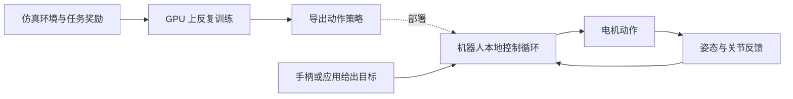

# Microduck 深度调研：低价双足机器人，能否成为具身智能的开发入口？

研究截止：2026 年 11 月 4 日。本文从产品、销量与交付、技术栈和竞争定位出发，分析 Microduck 适合怎样的具身智能实验。

本报告基于官方网页、固定版本代码与文档、公司公告和注明出处的媒体报道。没有进行 Microduck 真机测试或重新训练；官方实验结果不等于独立复现结果。文中的商业判断与实验建议均为分析，不是厂商承诺。

## 1. 核心判断

**Microduck 最值得关注的价值，是把双足运动控制、仿真训练和真机部署连接到一个消费级价格的开发平台上。** 它有机会降低学习具身智能的门槛；目前的证据还不足以把它视为成熟的通用家庭机器人。

对开发者，它值得研究的不是单个可爱动作，而是能否完成“定义任务—训练策略—测试失败—迁移真机—回收数据”的完整循环。对商业观察者，下一步应看交付、可靠性和持续使用，而不是继续把不同口径的订单新闻相加。

本次核查得到五个关键结论：

- **有真实技术基础。** 官方运行时、物理仿真、训练环境及部署流程已经公开，可以检查具体任务的定义，而不只观看演示。[运行时仓库](https://github.com/pollen-robotics/microduck/tree/d13be2c1a2f4b1e0b0e499b08b92f870518b1384)
- **开源有明确边界。** 官方明确表示软件开源，机械和电子设计不属于其开源声明。[官方说明](https://pollen-robotics.com/microduck/press-kit/)
- **订单热度已有报道，交付规模仍待验证。** 10 月 23 日媒体报道预订超过 2 万；本轮未找到可核验的累计交付量。[TechCrunch](https://techcrunch.com/2026/10/23/hottest-toy-for-christmas-nvidia-ceo-plays-with-adorable-microduck-robots-20000-sell/)
- **导航能力应连同失败边界一起看。** 厂商发布了低成本深度传感器的定位实验，但实验条件与可用性不能省略。[官方 SLAM 实验](https://pollen-robotics.com/microduck/blog/microduck-slam/)
- **适合先用仿真验证研究目标。** 如果目标是“说一句话，让机器人动”，应先完成指令控制；如果目标是“让机器人学会更稳地走”，才进入强化学习训练。

## 2. 产品定位：一个可编程的移动身体

官方价格为首发预订价 399 美元，税费与运费另计。主要规格如下；这是厂商公布的配置，不是本报告的实测值。[官方商店](https://store.pollen-robotics.com/products/microduck)

| 项目 | 官方披露 | 对使用者的含义（分析） |
|---|---|---|
| 体积与重量 | 高约 25 cm，重约 780 g | 适合室内小范围实验，但仍需要防跌落的测试空间 |
| 执行机构 | 15 个电机，可活动的喙 | 可以研究平衡、全身动作与有限物理交互 |
| 板上计算 | RK3566，1 GB 内存、32 GB 存储 | 更适合小型控制策略；不能据此预期运行大型通用模型 |
| 感知 | 摄像头、两个 IMU、8×8 ToF 深度阵列 | 适合研究多传感器协同，不应把深度阵列理解为高密度三维扫描仪 |
| 交互 | 麦克风、扬声器、NFC、Wi-Fi、蓝牙 | 为交互应用提供接口，硬件存在不等于所有应用已经成熟 |
| 电池 | 可更换，标称约一小时 | 应把动作强度、续航和充换电纳入实验安排 |

值得注意的是，官方 press kit 仍将摄像头分辨率、视场、深度量程和部分软件规格列为未最终确定；因此不宜用尚未公布的参数推算导航精度或视觉模型性能。[规格状态](https://pollen-robotics.com/microduck/press-kit/)

**产品判断：**它的形态优势在于，小型双足身体既能提供直观反馈，也能暴露真实机器人问题：滑倒、延迟、关节间隙、碰撞和恢复。它的限制也来自同一形态：移动和低头接触物体，不等于拥有通用机械臂的操作空间。

## 3. 到底卖了多少？先区分五种数字

“预订”“净订单”“已生产”“已交付”“收入”不是同一回事。预订可能被取消；生产可能尚未发货；订单金额也不等于确认收入。

### 3.1 可核查的时间线

| 时间 | 公开信息 | 本报告采用的口径 |
|---|---|---|
| 2026-08-27 | 官方开放预订 | 产品开始接受预订，不代表已经交付。[发布资料](https://pollen-robotics.com/microduck/press-kit/) |
| 2026-10-22 | CEO 帖子的第三方镜像显示，预计次日总预订越过 2 万 | 属于预测性表述；原始 X 页面本轮未能直接读取，镜像证据等级较低。[帖子镜像](https://teapawt.org/ClementDelangue/status/2113322519423758540) |
| 2026-10-23 | 媒体报道预订超过 2 万 | 可作为媒体披露的量级，不能当作经审计的净销量；报道链接见本报告开头 |
| 2026-10-26 | 韩媒出现 75 万个舵机、对应 5 万台机器人的供货报道 | 供应链叙述不能直接换算成终端已售数量。[当日报道](https://biz.chosun.com/en/en-industry/2026/10/26/D5ARVCUOWVCOLN4XIOKXT4TKXY/?outputType=amp) |
| 2026-10-28 | Robotis 正式澄清：尚未签订供货合同或收到订单 | 公告针对双方供货关系，不是否认消费者预订。[DART 公告](https://dart.fss.or.kr/dsaf001/main.do?rcpNo=20261028900684) |
| 截至本次调研 | 未取得公开订单后台、净订单统计或累计交付统计 | 不填未经验证的“最新准确销量” |

10 月 28 日的 Robotis 公告说明：Pollen 来访讨论舵机规格与技术事项，双方举行了面向未来供货关系的纪念签字仪式，彼时仍在协商；预定再次公告日期为 11 月 27 日。这个结论有时间边界，不能据此推断之后始终没有签约。[公告正文](https://dart.fss.or.kr/report/viewer.do?rcpNo=20261028900684&dcmNo=11631619&eleId=0&offset=0&length=0&dtd=HTML)

**对“卖了多少”的稳妥回答：公开报道已到约 2 万台预订量级，但截至 11 月 4 日的准确净订单与实际交付量，本轮无法确认。5 万台不能作为已售或已交付的结论。**

### 3.2 交付与购买成本

官方仍把首次交付描述为争取在 2026 年圣诞节前完成。这是首批交付目标，不是现在下单的逐单交期保证。本轮读取的官方页面没有验证到网络流传的“新订单统一等到 2027 年 4 月以后”。[官方发货政策](https://store.pollen-robotics.com/policies/shipping-policy)

商店列出的首发市场包括美加、欧盟、英国、挪威、瑞士、日韩；没有列出中国大陆。本轮未确认大陆官方直邮或授权经销路径。399 美元也不是中国用户的完整到手成本。[销售地区](https://store.pollen-robotics.com/products/microduck)

对个人，预算应包括运费税费、可能的转运、训练算力与维修备件；对团队，还应计入环境搭建和维护人力。在这些费用未明确前，不建议用单一标价做采购比较。

## 4. 技术栈：理解它如何“学会动作”

下面是对现有架构的简化解释，虚线表示部署步骤，不是实时网络控制链路：

运行时以 50 Hz 在板上执行策略。原有训练项目基于 mjlab / MuJoCo Warp 与 PPO，导出 ONNX，再交给机器人运行；部分训练任务共享 61 维观测、14 维输出接口。策略输出维度与整机 15 个电机不是同一计数口径。[运行时说明](https://github.com/pollen-robotics/microduck/blob/d13be2c1a2f4b1e0b0e499b08b92f870518b1384/README.md)、[训练说明](https://github.com/pollen-robotics/microduck_rl/blob/bae39f5900b318f7e87fc485c30a31213cfa14eb/README.md)

2026 年 10 月 21 日，NVIDIA 作者另外发布 Isaac Lab 3.0 / Newton 训练教程。它采用 Linux 与支持的 NVIDIA GPU，并强调导出时保持观测顺序、归一化和动作缩放一致。这是新增的一条训练路线，不能把两个项目的安装步骤和接口细节混写成同一个工具。[NVIDIA 教程](https://huggingface.co/blog/nvidia/microduck-isaac-lab-sim-to-real)

**分析：**这套方案的价值，在于训练与运行解耦。训练可能使用大量并行环境，但学成后的控制策略可以很小。机器人执行一步动作，不需要先把问题发给云端聊天模型。另一方面，接口形状一致只是必要条件，不能保证任意策略换到任意版本都能稳定运行。

### 4.1 仿真不是单纯播放动画

官方物理仿真可以让真实运行时和控制循环驱动 MuJoCo 身体；另有不带物理身体的 dry-run 模式。两者应区分。[仿真使用文档](https://github.com/pollen-robotics/microduck/blob/d13be2c1a2f4b1e0b0e499b08b92f870518b1384/docs/robot/simulation.md)

但该仿真不覆盖真实舵机总线、蓝牙无线电、相机 ISP、NPU、硬件编码及热与电池行为等。[官方仿真边界](https://github.com/pollen-robotics/microduck/blob/d13be2c1a2f4b1e0b0e499b08b92f870518b1384/docs/design/simulation.md)

因此，仿真适合发现动作逻辑、策略切换和部分物理稳定性的问题；它不能替代真机的可靠性、驱动、温升与耐久测试。真正有价值的迁移实验，应记录“哪些条件下失败”，而不只选出一段成功视频。

### 4.2 动作演示应该如何解读

当前训练库的 BallKick 任务明确写明，执行策略不观察球；GroundPick 的任务描述则是喙触地后恢复站立。这些是有用的运动技能，但不构成任意目标检测与抓取的证据。[任务定义](https://github.com/pollen-robotics/microduck_rl/blob/bae39f5900b318f7e87fc485c30a31213cfa14eb/README.md#tasks)

评估一个演示时，应问：目标是否由人预先对齐？物体移动后还能完成吗？失败能否自行恢复？换地面、光照或物体后成功率如何？这些问题决定它是特定技能、感知驱动行为，还是更通用的自主任务系统。

## 5. 自主导航：已经有进展，但尚不能外推成全屋可靠运行

官方 10 月 23 日实验采用 8×8 深度传感器：每秒 15 帧、64 个距离采样，约一米以内较可靠；建图程序运行在板上，移动时跟随里程计，停稳后进行地图匹配。两段测试的主要结果如下。[官方实验与数据说明](https://pollen-robotics.com/microduck/blog/microduck-slam/)

| 指标 | 4 分钟测试 | 7.5 分钟测试 |
|---|---:|---:|
| 停止位置误差中位数 | 2.7 cm | 4.8 cm |
| 最差停止位置误差 | 6.6 cm | 15 cm |
| 系统报告定位有效的时间占比 | 60% | 63% |
| 在定位有效期间，误差小于 15 cm 的比例 | 99% | 94% |

最后一行的分母是“定位有效期间”，不是整个测试时长。**不能把它改写为“全程定位准确率 99%”。**

**分析：**发布带真值的数据和失效状态，比只展示漂亮地图更有研究价值。但两段短测试尚不足以证明跨家庭、跨家具布置与长时间运行的可靠性。需要进一步评估重复纹理、家具变化、持续行走、被搬动和定位丢失后的恢复。建图、定位、规划路线和执行完整任务，也应分别验收。

## 6. 软件开源的价值与限制

公开训练代码，使开发者有机会修改任务、观察策略行为并比较实验结果。它并不自动赋予复制整机的权利：机械和电子设计被官方排除在开源硬件范围之外，训练库中的仿真模型文件还采用独立的 CC BY-NC-SA 许可。[官方范围说明](https://pollen-robotics.com/microduck/press-kit/)、[模型许可](https://github.com/pollen-robotics/microduck_rl/blob/bae39f5900b318f7e87fc485c30a31213cfa14eb/LICENSE-MODELS.md)

**分析：**对学习和软件实验，这种开放程度已经有实际价值；对计划制造兼容硬件、销售模型素材或建立商业衍生产品的团队，则需要逐项确认文件许可和供应链依赖。还应区分“代码存在”“接口稳定”“官方支持”“进入交付固件”四种状态。

## 7. 与 Reachy Mini 以及其他机器人怎么选

以下按研究目标比较，不作未经实测的综合性能排名。Reachy Mini 官方定位偏人机互动与 AI 实验；当前还公布了 Wireless 版本的轮式底座，因此不宜笼统说它永远不能移动。[Reachy Mini 当前产品页](https://pollen-robotics.com/reachy-mini/)

| 主要目标 | 优先考虑的形态 | 选择理由（分析） |
|---|---|---|
| 对话、视线、情绪表达、语音控制 | Reachy Mini 一类交互机器人 | 可以先把感知与交互链路做好，不必同时解决双足平衡 |
| 学习走路、摔倒恢复、强化学习迁移 | Microduck 一类小型双足平台 | 运动控制本身就是核心实验对象 |
| 抓取、装配、精细操作 | 带夹爪的机械臂 | 任务与执行器形态更匹配 |
| 稳定移动、较大范围巡航 | 按场景评估轮式或四足平台 | 应优先比较地形、续航、负载与导航可靠性 |
| 主要研究训练算法 | 先用纯仿真 | 能降低试错成本，之后再选择要验证的实体 |

遇到“说话没反应”时，更换机器人身体不一定解决问题。声音采集、识别、指令解析、连接控制端和动作执行，任何一环失败都可能表现为不动。这是应用链路问题，应与运动策略是否训练成功分开排查。

## 8. 商业前景：硬件热度如何转化为持续价值

以下是基于公开产品结构的商业分析，不是已披露的经营结果。

### 有利因素

第一，可见的身体动作让用户容易理解实验结果，适合教学、创作者展示和社区交流。第二，同一硬件与策略接口若能保持稳定，会降低复现实验的成本。第三，模型分享、教程和评测可以使一次硬件购买产生后续使用价值。

### 核心挑战

双足机器人进入普通用户环境后，失败不仅是软件报错，还可能成为跌倒、维修和退货。首发热度要转化为健康业务，需要解决批次一致性、易损件供应、版本升级与初次使用体验。复杂环境的支持成本，也可能侵蚀低标价带来的优势。

不能从 399 美元倒推毛利率。本轮没有取得 BOM、批量采购价格、制造良率、渠道成本或售后成本。若只作情景算术，2 万台全部以 399 美元成交，对应约 798 万美元商品金额；这不是已确认收入，也未考虑取消、折扣、税费和成本。

### 比关注热度更有效的指标

| 问题 | 应取得的数据 |
|---|---|
| 需求是否转化成兑现能力？ | 净预订、取消率、累计交付、交期分布 |
| 普通用户能否成功开始？ | 从开箱到第一次稳定控制的时间、安装失败率 |
| 用户是否持续使用？ | 30/90 天活跃、重复运行任务、持续贡献者 |
| 社区内容是否可用？ | 在明确版本上可复现的策略数、复现通过率 |
| 硬件是否经济可靠？ | 故障与退货率、维修周期、备件价格 |

这些指标目前不能由 GitHub 热度、展会视频或预订新闻替代。商业判断应随着交付证据更新，而不是现在就断言成功或失败。

## 9. 开发者实验路线：先把四件事分开

| 行为 | 实际在做什么 | 是否必然需要云服务 |
|---|---|---|
| 说“向左走”，触发已有动作 | 语音识别与指令控制 | 不必然，取决于识别与应用实现 |
| 在电脑里观看已有策略走路 | 仿真与策略推理 | 不必然 |
| 反复试错，优化走路策略 | 强化学习训练 | 不必然；需要适配的训练算力 |
| 将导出的策略装进机器人 | 部署与本地执行 | 不代表运行时逐步依赖云端 |

官方训练库要求 CUDA GPU，同时提供 CPU MuJoCo 策略回放；也可把训练任务提交至 Hugging Face Jobs。后者的账户认证和云端计费是另一层服务。[训练库](https://github.com/pollen-robotics/microduck_rl/blob/bae39f5900b318f7e87fc485c30a31213cfa14eb/README.md)、[HF Jobs 说明](https://github.com/pollen-robotics/microduck_rl/blob/bae39f5900b318f7e87fc485c30a31213cfa14eb/scripts/hf/README.md)

因此，使用 Mac 的开发者适合先尝试 CPU 策略回放、应用开发和实验分析；不能把官方 CUDA 训练步骤直接理解成支持 Apple GPU。下面是建议的四阶段实验，不是对工期或结果的保证。

| 阶段 | 做什么 | 如何验收 |
|---|---|---|
| 1：控制基线 | 用按钮/键盘运行固定策略，测试启动、停止、转向 | 每次都保存指令与状态日志，能复现同一问题 |
| 2：语音接入 | 本地识别有限指令，映射为已验证的控制动作 | 分别统计识别率、控制请求成功率、动作完成率，避免只看最终是否动了 |
| 3：训练复现 | 在支持的 NVIDIA GPU 上复现一个现成任务 | 保存代码版本、随机种子、配置与模型；与基线在同一场景比较 |
| 4：鲁棒性评估 | 改变摩擦、延迟等条件；再决定是否进入真机 | 对多次试验记录跌倒、恢复、误差和耗时，公布失败案例 |

建议第一项研究问题选“在不同摩擦和控制延迟下，步态稳定性如何变化”。它范围清楚、可以测量，也能直接体现具身智能与纯对话应用的区别。暂不把“听懂任意中文并在家里自主完成任务”作为入门验收标准。

## 10. 结论与待验证清单

**当前最合理的定位是：值得认真实验的小型双足开发平台，商业兑现仍需要交付与长期使用数据。** 对初学者，先验证仿真控制与一个可测量的学习任务，比为了获得语音响应而直接更换机器人更有价值。

进一步决定购买或团队投入之前，还需要确认：

1. 当前订单的实际交期、中国大陆购买路径与完整成本。
2. 正式交付固件包含哪些功能，哪些仍是开发分支或路线图。
3. 真机在不同地面上的成功率、恢复能力、续航与故障情况。
4. SDK/API 稳定性、备件供应、维修与退货的实际执行体验。
5. 实验是否真正需要双足身体，还是仿真、交互机器人或机械臂更合适。

以上缺口不会否定现有技术价值，但会影响购买决策、课程交付和商业化预期。

---

## 资料与版本

技术分析使用以下代码版本；正文链接保留固定提交，以便复核：

- 运行时 `microduck/main`：`d13be2c1a2f4b1e0b0e499b08b92f870518b1384`，提交时间 2026-11-03。
- 训练库 `microduck_rl/develop`：`bae39f5900b318f7e87fc485c30a31213cfa14eb`，提交时间 2026-10-27。

证据等级：官方规格说明厂商的当前承诺；固定版本代码说明实现与接口存在；公司公告说明特定时点的披露；媒体和社交镜像用于补充线索。它们都不能替代独立真机测试或审计后的销售数据。

## 延伸阅读

- [机器人开源生态与学习路径](/writing/robotics-open-source-learning/)
- [Dyna Robotics 与具身智能](/writing/dyna-robotics-embodied-ai/)
- [具身智能专题](/series/embodied-intelligence/)
