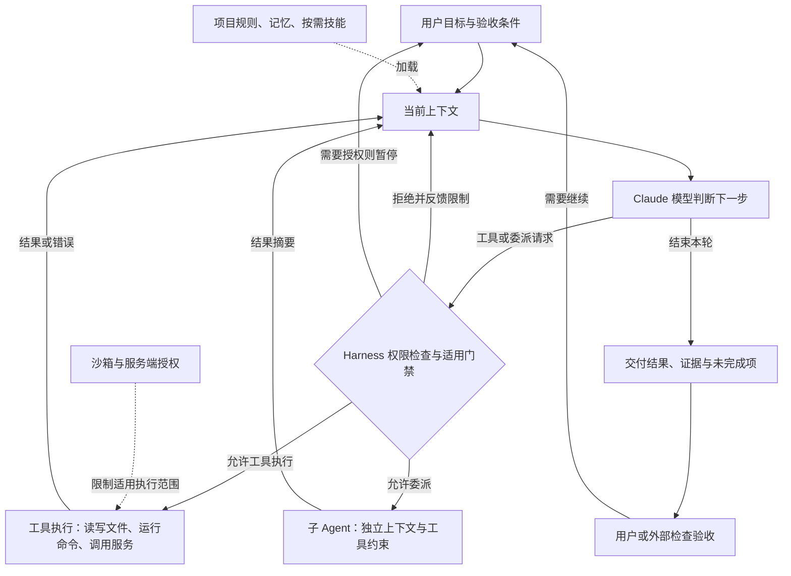

让模型写出一段代码，与让它在真实项目里完成一次修改，中间隔着大量工程问题：读哪些文件，什么时候执行命令，失败后怎么调整，怎样保留进度，以及谁来判断任务已经完成。

Claude Code 的架构价值，就在于把这些问题组织成一个可以持续工作的系统。它以模型驱动的执行循环为中心，将上下文、工具、权限和状态管理放在循环周围。**这种设计擅长处理路径未知、反馈明确的开发任务；代价是执行路径难以预先确定，长任务的信息保真和外部副作用仍需要额外治理。**

本文依据 2026-09-20 查阅的官方文档，聚焦本地开发任务的核心机制。公开仓库不能提供完整核心实现的源码审计依据；下图是职责抽象，不是内部模块复原。文中的优缺点是架构分析，“登录超时修复”是假设案例，未运行 Claude Code、调用模型或进行性能实测。[官方架构说明](https://code.claude.com/docs/en/how-claude-code-works) · [官方仓库](https://github.com/anthropics/claude-code)

<!-- diagram:claude-code-internals-overview-1 -->

图中的权限节点合并了多种检查，不表示固定内部调用顺序。子 Agent 的工具同样受其适用权限约束；内置 Bash 沙箱有自己的覆盖范围，不能据此推断所有 MCP 服务都处于同一沙箱内。模型结束一轮输出，也不代表验收已经通过。

## 一、自主循环：适应未知问题，也让执行路径难以预测

假设任务是：“修复登录偶发超时，保留原来的重试上限，补充回归测试，不推送代码。”

问题可能来自客户端超时设置、服务端重试，或者连接池。用户通常只能描述现象，无法提前给出完整步骤。Claude Code 可以搜索实现、读取日志、修改文件、运行测试，再根据工具返回的结果决定下一步。官方将这一过程概括为收集上下文、采取行动和验证结果，三者交替发生。[执行循环](https://code.claude.com/docs/en/how-claude-code-works#the-agentic-loop)

**优点是把路径选择交给模型，把事实反馈交给工具。** 相比预先规定每条分支的流程，这种方式更能容纳“运行后才知道哪里有问题”的工作。测试暴露出新错误，Agent 可以回到代码继续调查；仓库结构变化，也不必先重写一套完整流程。

代价来自同一个设计：下一步依赖模型对当前证据的解释。它可能过早锁定错误原因，也可能为了让测试变绿而削弱测试。工具调用成功只能证明动作执行成功，不能证明修改符合业务意图。

例如，把超时时间从 3 秒调成 30 秒，可能让测试通过，却没有解决连接泄漏，还延长了用户等待。这里缺少的不是一次额外模型调用，而是能区分“掩盖症状”和“修复原因”的验收证据。

因此，自主循环需要一个明确的外部终点：可复现的失败、修改后的对应回归、保留原有约束的差异审查。执行步骤可以动态变化，验收目标不能由 Agent 为了完成任务自行降低。对于步骤固定的格式检查、构建和发布门禁，确定性脚本往往更容易复现与维护。

## 二、上下文管理：降低信息负担，也引入选择与压缩损失

一个真实仓库装不进每轮模型输入。Claude Code 必须决定哪些信息现在需要、哪些稍后再读，以及哪些历史可以压缩。

它提供了不同寿命的信息载体：`CLAUDE.md` 保存团队规则，Auto Memory 保存 Agent 积累的经验，Skills 按需提供专项方法。自动压缩则让长会话继续推进。这些机制影响的是后续输入，并不意味着模型参数被重新训练。[记忆机制](https://code.claude.com/docs/en/memory) · [Skills](https://code.claude.com/docs/en/skills)

**优点是减少重复说明，把有限上下文留给当前问题。** 登录案例中的“测试入口”和“重试上限不能变”适合长期规则；一次调查产生的数千行日志则不适合永久常驻。

但持久化会同时保存正确知识和错误经验。假如一次临时排障得到“关闭证书校验即可恢复”的结论，未经审查写进记忆，未来任务就可能反复采用它。Markdown 可读、可编辑，降低了治理门槛，却不会自动判断经验是否仍然成立。

压缩也不是无损保存。官方明确提醒，早期细节指令可能在上下文整理中丢失。对长任务而言，重要决策应落在可重新读取的文件、测试与提交记录中，恢复时再核对，而不能只依赖模型“还记得”。[上下文窗口](https://code.claude.com/docs/en/how-claude-code-works#the-context-window)

### 子 Agent 隔离了上下文，没有自动隔离所有副作用

子 Agent 在独立上下文中处理任务，再把结果带回主会话，适合消化搜索结果或大量日志；其工具范围也可以单独限制。[Subagents](https://code.claude.com/docs/en/sub-agents)

收益是主会话不必承担所有探索细节。代价是摘要可能遗漏反例，主 Agent 也可能把“没有搜到”误读为“不存在”。因此，委派结果最好携带关键文件位置、验证方法和未覆盖范围，必要时返回原始证据重新检查。

还要区分上下文隔离与工作区隔离：两个 Agent 使用不同上下文，仍可能修改同一目录。需要隔离代码改动时，应显式使用独立工作区或 worktree；这也不会隔离共同访问的数据库和远端服务。

并行是否节省成本同样取决于任务。它可能缩短等待时间，但每个子任务仍要读取信息、执行工具并生成结果，还可能重复探索。评估时应同时看总消耗和交付时间，不能只看主会话变短了多少。[成本管理](https://code.claude.com/docs/en/costs)

## 三、工具与权限：复用开发环境，也继承环境的风险

文件工具与 Shell 是 Claude Code 的重要优势。它能利用项目已有的测试框架、构建工具和命令行程序，减少为每种工作重新建设工具接口的成本。

问题是，通用执行能力的含义远大于工具名称。`npm test` 可能只跑本地测试，也可能触发项目脚本、访问网络或连接共享环境。允许一个命令入口，并不等于已经理解其全部副作用。

Claude Code 为此提供权限规则与沙箱：权限决定工具调用如何被允许、询问或拒绝；沙箱在覆盖范围内限制进程可访问的文件和网络。两者可以减少依赖模型自行遵守限制的程度。[权限配置](https://code.claude.com/docs/en/permissions) · [Bash 沙箱](https://code.claude.com/docs/en/sandboxing)

**优点是让自主执行拥有可配置的边界；代价是边界需要针对实际路径维护。** 太宽的授权放大出错影响，太细的逐次确认则打断工作，容易让用户机械点击允许。合理方向是在小范围内自动执行，把高影响动作单独控制。

尤其不能混淆三层约束：

| 约束 | 解决什么问题 | 不能单独保证什么 |
| --- | --- | --- |
| `CLAUDE.md` 中的要求 | 告诉模型应该怎样工作 | 无法独立阻止越权执行 |
| 工具权限与适用的执行前检查 | 限制经过这些入口的调用 | 不保证获准动作在业务上正确 |
| 沙箱、服务端授权与受限凭据 | 缩小资源访问和副作用范围 | 不替代代码正确性与验收 |

内置沙箱主要面向 Bash 执行；例外命令、沙箱外运行路径和 MCP 服务需要分别核对。允许访问一个域名，也不能推出向该域名发送的所有内容都合适。

在登录案例中，“不推送代码”应保留在任务约束里；若要求形成可靠边界，还应限制远端写入能力，检查 Shell、Git 工具与 MCP 等可达路径。仅拦截字面上的 `git push`，不足以代表已经阻止所有远端写入。

## 四、扩展机制：职责划分清楚，组合之后仍有维护成本

Claude Code 没有要求把团队需求全部塞进一份系统提示，而是提供了不同扩展入口。这种分工本身值得借鉴：

| 机制 | 主要职责 | 在登录案例中的用途 |
| --- | --- | --- |
| CLAUDE.md / Memory | 保存规则与经验 | 测试入口、项目约束 |
| Skill | 提供可复用的工作方法 | 登录故障排查步骤 |
| MCP | 连接外部工具与数据 | 查询错误监控或工单 |
| Hook | 在特定事件触发处理 | 执行前检查、执行后记录 |
| Subagent | 承担有边界的子任务 | 独立分析日志并返回证据 |

**优点是可以按职责扩展，不必修改核心循环。** Skill 教模型怎样处理问题，MCP 让它获得数据或执行能力，Hook 将部分流程要求落实到事件处理。三者互补，也不能互相替代。[Skills 文档](https://code.claude.com/docs/en/skills) · [MCP 文档](https://code.claude.com/docs/en/mcp) · [Hooks 文档](https://code.claude.com/docs/en/hooks)

代价是配置会产生组合效应。项目规则要求不改接口，Skill 却引导重构；Hook 在编辑后格式化文件，另一个子任务仍根据旧内容修改。单个扩展都能工作，不代表组合后的流程仍符合预期。

Hook 的“按事件触发”也不等于整个系统确定性执行。同步 `PreToolUse` 可以参与阻断适用的工具调用；事后处理不能撤销已经发生的副作用，异步处理不能充当前置门禁。事件覆盖、超时、失败处理和脚本权限都需要核对，不能把一段 Hook 当成覆盖所有访问路径的安全系统。

MCP 则增加了另一类边界：远端工具拥有自己的身份、权限与失败语义。接入成功不等于结果可信；从工单或网页返回的文本也可能包含诱导指令。官方要求核实服务器可信度，并提醒外部内容带来的提示注入风险。[MCP 信任提示](https://code.claude.com/docs/en/mcp#find-and-build-mcp-servers)

我的判断是：少量职责清楚、来源可追踪的扩展，比不断增加功能更有价值。团队应能解释每项扩展何时加载、能做什么、失败后怎么办，以及停用它是否会改变任务边界。

## 五、会话与检查点：方便继续工作，不等于事务恢复

开发过程经常需要试错。保存会话让用户可以接着讨论，检查点让部分编辑可以撤回。这降低了尝试方案的心理成本，也让 Agent 的长过程更容易被接管。

不过，“恢复对话”“恢复文件”和“恢复外部世界”是三件不同的事。当前官方文档明确指出，Checkpoint 不跟踪 Bash 命令造成的文件修改；多数子 Agent 编辑也不属于主会话检查点的恢复范围，具体取决于运行方式。[Checkpoint 的限制](https://code.claude.com/docs/en/checkpointing#limitations)

| 状态 | 适合依靠的机制 | 恢复后还要确认 |
| --- | --- | --- |
| 讨论与任务线索 | 会话恢复 | 历史判断是否仍适用 |
| 支持范围内的文件编辑 | Checkpoint、Git 差异与版本 | 当前目录是否还有其他来源的修改 |
| 数据库、远端 API、部署 | 对应系统的记录与恢复机制 | 动作实际成功、失败还是未知 |

假设 Agent 调用测试环境的迁移接口，服务端已执行，但响应丢失。恢复会话只能找回“曾经尝试迁移”的线索，无法证明迁移没有发生。此时直接重试可能产生重复副作用，应先根据操作标识查询实际状态。

这说明，**会话持久化为交互式开发提供连续性，却不能直接推出跨系统事务、幂等重试或可靠补偿能力。** 若将 Claude Code 接入长期自动化流程，这些要求应由外部任务系统和工具服务明确承担。更多区分见 [Agent Runtime](/writing/agent-runtime/) 与 [Runtime 技术选型](/writing/agent-runtime-selection/)。

## 六、怎样判断它是否适合自己的任务

综合以上取舍，关键问题是：这项工作能否在受限环境里探索，并通过可靠证据验收？

| 任务条件 | 架构上的匹配程度 | 应补足的条件 |
| --- | --- | --- |
| 陌生仓库排障，有复现与测试 | 高：需要动态探索和反馈 | 保留失败用例，审查修改意图 |
| 文档、局部重构、开发辅助 | 高：输出可检查，修改可管理 | 控制任务范围，按需加载知识 |
| 多任务并行修改代码 | 有条件：可以拆分探索 | 隔离工作区，明确文件归属和集成检查 |
| 固定步骤、强复现要求的流水线 | 自主决策的收益有限 | 用确定性流程控制顺序和门禁 |
| 跨系统生产写入、长期无人值守 | 仅靠核心会话机制不足 | 服务端授权、幂等、对账、审计与恢复 |

还有一项长期成本：Claude Code 围绕 Claude 模型族及其工具使用方式构建。官方支持不同模型配置和服务接入渠道，但这不等于可以无成本替换成任意厂商模型。模型、产品配置与扩展一同升级时，行为也可能变化；对可控性要求较高的团队，应记录版本和配置，并用自己的代表任务回归，而不是依赖一份过时的“最佳配置”。这是从产品耦合关系推导出的维护成本，不是跨模型实测结论。[模型配置](https://code.claude.com/docs/en/model-config)

Claude Code 最值得借鉴的，是把模型判断放进真实工具反馈循环，同时用上下文管理和执行约束支撑它持续工作。它把开发者从逐步指挥中释放出来，也把开发者的职责推向更上层：定义目标，建立边界，提供证据，审查结果。

**它的优势与局限来自同一选择：允许模型动态决定怎样完成任务。** 对探索式开发，这种自由很有价值；当任务要求严格顺序、可靠恢复和不可越过的业务规则时，就需要把这些要求落实到模型之外。理解这条边界，才能既用好 Claude Code，也从它的架构中学到可复用的设计原则。
