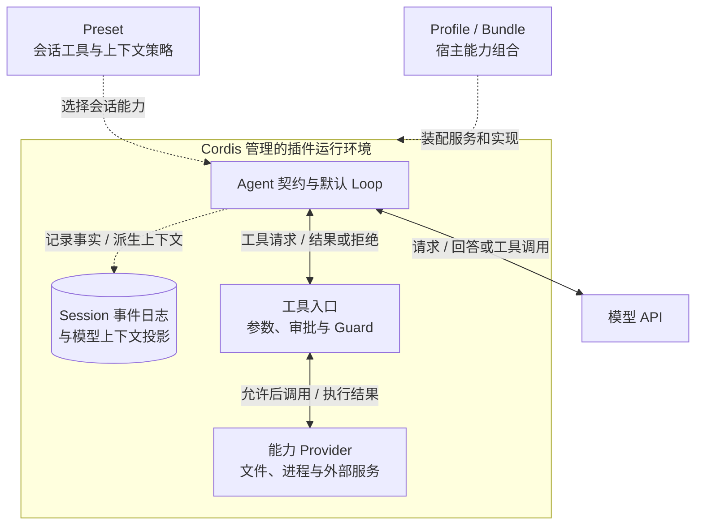

一个 Coding Agent 接到任务：“修复登录超时，运行测试，不部署。”调用模型只是开头。它还要读取代码、修改文件、执行命令、保存进度，并在用户追加要求、工具失败或进程中断时继续保持行为一致。

DeepSeek Harness 的架构，就是对这些运行问题的一种系统回答。它把模型适配器、工具、会话记录，甚至 Agent 循环本身都做成 Cordis 插件。**它最大的优点，是让变化发生在明确的接口上；最大的代价，是系统行为需要由一组插件、事件和配置共同解释。**

判断这套设计是否值得采用，关键在于：你的产品是否需要长期更换和组合能力，以及团队是否有能力维护这些组合。

> 本文核对至 2026-09-20，采用官方 `0.1.6-alpha.2` 对应提交 [`ddefc45`](https://github.com/deepseek-ai/deepseek-harness/tree/ddefc45fbc7f8e46dd73185e68295696d1297887)。这是开发者预览版本。下文依据官方文档和关键源码作静态分析；修复任务是说明性假设，没有运行真实 Agent、模型或沙箱测试。

## 一、整体架构：把执行循环放进可组合的运行环境

先看最重要的职责关系。下面是简化架构图，省略流式 UI、取消和重试分支；虚线表示配置与记录关系，实线表示请求和反馈。

这几个名字容易混淆。**Profile** 决定应用以 Web、SDK 或 headless 等形态启动；**Bundle** 是它叠加的一组插件配置；**Preset** 决定一个会话使用哪些工具、提示词与上下文策略。宿主提供执行条件，会话在这些条件下选择能力。[官方架构说明](https://github.com/deepseek-ai/deepseek-harness/blob/ddefc45fbc7f8e46dd73185e68295696d1297887/docs/architecture.md)

默认 Loop 把工作划成两层：一次模型请求及其触发的工具执行构成 Step；一个输入工作段可以包含多个 Step，构成 Turn。读取代码、修改代码、运行测试，通常需要多次模型与工具往返。工具结果返回循环后，才能成为下一次模型判断的依据。

公共 `Agent` 契约与 `agent-loop` 实现分开，因此调用者可以依赖稳定接口，默认循环也保留替换空间。但替换者仍要遵守输入、取消、事件和收尾约定。**实现可换，不代表运行语义可以随意改变。** 同样，Turn 结束只表示这一工作段收尾，测试是否通过、问题是否解决，仍需独立验收。[默认 Loop](https://github.com/deepseek-ai/deepseek-harness/blob/ddefc45fbc7f8e46dd73185e68295696d1297887/packages/core/agent-loop/README.md)

## 二、万物插件化：降低扩展成本，提高理解成本

普通插件系统往往保留一个固定主程序，只允许扩展工具。DeepSeek Harness 更进一步：模型连接、会话存储、执行循环也参与组合。它把复杂性集中到两件事上：依赖如何连接，资源何时释放。

Cordis 让插件声明所需服务。依赖没有就绪时，插件可以等待；插件卸载时，框架清理它注册的监听器、服务和子插件。框架之外的连接、定时器或文件监听，需要作者放进 `ctx.effect()` 并提供清理函数。卸载的可靠性仍取决于资源是否正确纳入管理；多个异步清理也不能想当然地视为严格串行。[生命周期与 Effect](https://github.com/deepseek-ai/deepseek-harness/blob/ddefc45fbc7f8e46dd73185e68295696d1297887/docs/cordis-tutorial/02-lifecycle-and-effects.md)

这解决了一个实际问题：当文件搜索服务升级时，旧注册和监听器应该退出，新实现接管，而不是越热更新越多一份回调。**资源退出成为框架契约，扩展能力才有机会被长期维护。** 但删除监听器不会撤销已经修改的文件，更不会自动回滚一次远端业务操作。

另一项重要设计，是将能力拆成接口、实现和使用者。例如文件工具依赖文件服务，底层可以接本地或远程执行环境。官方称这类边界为 Capability Seam。更换实现时，相关工具不必分别增加一套远程分支；文件系统与子进程还要指向同一个执行环境，才能避免“本地读文件、远端跑命令”的错位。[能力接口与 Provider](https://github.com/deepseek-ai/deepseek-harness/blob/ddefc45fbc7f8e46dd73185e68295696d1297887/docs/architecture.md#capability-seams)

代价出现在排查故障时。一次工具没有执行，原因可能是服务缺失、作用域不匹配、配置覆盖、策略短路，也可能是插件卸载。读一条函数调用链已经不够，还要还原当时生效的组合。

尤其是 Waterfall 事件：监听器通过 `next()` 把控制权交给下游，也可以直接返回决定。它方便加入审批、路由和拦截，但一个只想记日志的插件忘记调用 `next()`，也可能截断执行。因此，插件数量增加后，团队需要调试的对象是**整条中间件链的顺序与行为**。[事件机制](https://github.com/deepseek-ai/deepseek-harness/blob/ddefc45fbc7f8e46dd73185e68295696d1297887/docs/cordis-tutorial/04-events.md)

配置也有类似取舍。Profile 的 Patch 按稳定 ID 替换整行配置，避免深层继承难以解释；Preset 则拥有自己的完整组合，复制后会与上游产生维护差异。而且一个会话产生消息或工具调用后，就不能再切换 Preset，以免新能力集无法解释旧历史。它提供了可组合性，同时主动限制了一部分动态变化。[Preset 约束](https://github.com/deepseek-ai/deepseek-harness/blob/ddefc45fbc7f8e46dd73185e68295696d1297887/packages/preset/agent-presets/README.md)

我的判断是：这对需要多个模型、工具集和执行环境的平台很有价值；对于只有固定工具、单一流程的小应用，插件生命周期与配置体系可能比业务本身更难维护。

## 三、事件日志：更容易解释过去，恢复仍有边界

Agent 最容易出现的状态问题，是模型历史、界面和执行记录各保存一份事实。界面显示“测试通过”，模型上下文却只有旧报错；重启后，又不知道最后一次命令到底有没有执行。

DeepSeek Harness 以追加式 Session 事件作为公共事实源，再从中派生模型上下文和其他视图。用户消息、系统提示、工具调用与结果进入日志，当前请求通过投影重建。源码还提供请求重建不变量检查，用来核对发送的消息、工具和配置是否与日志推导一致。[Session 设计](https://github.com/deepseek-ai/deepseek-harness/blob/ddefc45fbc7f8e46dd73185e68295696d1297887/docs/subsystems/session.md)；[请求一致性检查源码](https://github.com/deepseek-ai/deepseek-harness/blob/ddefc45fbc7f8e46dd73185e68295696d1297887/packages/core/agent-loop/src/invariant.ts)

回到登录超时案例，这意味着“依据哪个报错修改了哪个文件”有机会沿同一组事件追溯。上下文压缩也不必删除旧事实：系统保留原始事件，通过新增摘要与替换关系，让模型看到更短的当前视图。压缩的开始、摘要和结束分别记录，使中途失败能够被识别。[上下文压缩](https://github.com/deepseek-ai/deepseek-harness/blob/ddefc45fbc7f8e46dd73185e68295696d1297887/docs/subsystems/compaction.md)

收益是审计和上下文管理可以分开。代价是维护者需要同时理解原始事件、当前投影、压缩边界和日志版本。摘要是否遗漏“禁止部署”，仍是质量问题；原始证据存在，不保证模型当前看到了它。

还有三个边界必须分清。

**第一，流式展示不等于每个片段都已持久化。** 当前版本通过进程内 `agent/assistant-stream` 推送增量；结束时把紧凑流记录提交到 `assistant/message` 或仅用于记录尝试的 `assistant/attempt`。后者不会自动成为下一轮模型历史。源码的 `push()` 累积并广播片段，`settle()` 才执行对应的事件提交。硬崩溃发生在提交之前，就可能失去这一尝试的流记录。[流式结算源码](https://github.com/deepseek-ai/deepseek-harness/blob/ddefc45fbc7f8e46dd73185e68295696d1297887/packages/core/agent-loop/src/assistant-stream.ts)

**第二，Session 日志不自动等于磁盘落盘。** 没有挂载持久化 Provider 时，会话可以只存在于内存。崩溃后的可恢复范围，还受存储实现和 Flush 边界约束。事件模型提供组织事实的方法，持久性需要具体存储实现兑现。[Loop 与存储的衔接](https://github.com/deepseek-ai/deepseek-harness/blob/ddefc45fbc7f8e46dd73185e68295696d1297887/packages/core/agent-loop/README.md#persistence-integration)

**第三，重放记录不等于安全地重做操作。** 假设远端操作成功，进程却在写入 `tool/result` 前退出，日志只能告诉你结果缺失，不能证明操作没有发生。应用仍需要幂等键、状态查询或人工对账。追加日志改善了恢复依据，没有消除外部系统中的不确定性。

因此，这种设计更擅长回答“已记录的事实是什么、当前上下文如何形成”，不能单凭它承诺任意时刻无损恢复或业务操作只执行一次。

## 四、工具管线：权限约束更明确，但信任不能全部放在插件里

模型提出工具调用后，最重要的问题是：审批时看到的参数，是否就是最终执行的参数？

DeepSeek Harness 会先物化并冻结调用参数，再进入前置策略、最终 Guard、执行包装、工具本体、后置处理和结果结算。需要审批的调用，只有明确授权才继续；审批服务缺失不会成为默认放行的理由。结果或拒绝信息再返回 Loop，成为后续判断的输入。[工具管线](https://github.com/deepseek-ai/deepseek-harness/blob/ddefc45fbc7f8e46dd73185e68295696d1297887/docs/subsystems/tools.md)

其中最值得借鉴的是 **Guard 只能收紧权限**：它可以拒绝，不能返回一个更强的“允许”来推翻另一条 Guard。可排序的策略负责灵活交互，最终拒绝约束负责防止权限因插件顺序而意外变宽。[Guard 执行源码](https://github.com/deepseek-ai/deepseek-harness/blob/ddefc45fbc7f8e46dd73185e68295696d1297887/packages/core/tools/src/index.ts)

并发同样属于工具契约。只有被判定可安全并行的调用才进入有界并发池，独占调用形成顺序屏障。读取互不影响的文件可能适合并行，修改共享索引则需要额外协调。调度器落实声明，却无法替工具作者证明没有数据竞争。[工具调度源码](https://github.com/deepseek-ai/deepseek-harness/blob/ddefc45fbc7f8e46dd73185e68295696d1297887/packages/core/agent-loop/src/tool-calls.ts)

这套设计的优势，是把身份、参数、授权、执行和反馈连接成一条可检查的路径。代价则是每个工具都要承担更严格的接口责任，插件作者还必须区分三件常被混淆的事：

- **隐藏展示不等于隐藏数据。** 工具的结构化结果可以供程序继续使用；仅替换给模型看的文本，不会自动抹掉程序持有的值。后置策略需要隐藏该值时，必须阻断或替换它。
- **逻辑作用域不等于安全隔离。** 同进程插件拥有宿主代码执行能力；Guard 保护的是经过这条管线的调用，无法把恶意宿主插件变成可信代码。
- **文件沙箱不等于完整环境隔离。** 当前 `SandboxMode` 主要定义文件副作用范围，网络和进程可见性不在这套词汇内；部分平台还只能提供 `partial` enforcement，不能统称为完整约束。[工具结果边界](https://github.com/deepseek-ai/deepseek-harness/blob/ddefc45fbc7f8e46dd73185e68295696d1297887/docs/subsystems/tools.md)；[沙箱边界](https://github.com/deepseek-ai/deepseek-harness/blob/ddefc45fbc7f8e46dd73185e68295696d1297887/docs/subsystems/sandbox.md)

所以，“不部署”不能只写在 Prompt 里。它还应落实为工具与凭证范围、实际执行环境限制和结果验收。官方也明确说明项目未经安全审计，不能视为生产安全保证。[官方安全说明](https://github.com/deepseek-ai/deepseek-harness/blob/ddefc45fbc7f8e46dd73185e68295696d1297887/SAFETY.md)

## 五、PTC 与多 Agent：把工作分出去，也把协调问题带进来

当任务包含大量确定性工具调用时，让模型每走一步都重新推理未必划算。PTC（Programmatic Tool Calling）允许模型生成程序，在程序中搜索、读取、过滤与汇总，再把有用结果返回模型。

例如，定位登录超时可能要搜索二十个文件，再读取其中五个。PTC 可以把这个过程组织在一次程序执行中，减少模型往返，并让中间内容留在程序里。这里描述的是潜在收益，不能据此推导固定的 Token 节省比例或成功率提升。

当前版本已采用 `ptc-runtime-node`：每次调用启动新的 Node 进程，在所选策略下接入与 Bash 相同的文件沙箱，并管理时间、输出和进程清理。它不再是旧版本的 Worker Thread 执行方案。不过，Node API 仍然可用，网络能力没有因此自动消失；V8 堆限制也不是整个进程树的内存上限。[当前 PTC Provider](https://github.com/deepseek-ai/deepseek-harness/blob/ddefc45fbc7f8e46dd73185e68295696d1297887/packages/ptc-runtime/ptc-runtime-node/README.md)

PTC 的结构性代价是，推理问题部分转成了程序调试问题：程序可能超时，绑定调用可能失败，中间状态在下一次执行中不会自动保留。程序调用注册工具时仍经过工具约束，但直接 Node 操作依赖执行环境边界。普通工具回合也更方便模型在每一步重新判断，适合路径不断变化的探索任务。

还有一项审计取舍：规范化的工具原始值可以在执行中传递，但持久记录保存的是规定的内容投影与错误等字段；重放展示不保证重建全部中间程序值。需要复算的数据应由应用显式保留。[工具值与持久记录](https://github.com/deepseek-ai/deepseek-harness/blob/ddefc45fbc7f8e46dd73185e68295696d1297887/docs/subsystems/tools.md)

多 Agent 解决另一种问题：把任务交给独立上下文或外部执行者。DeepSeek Harness 通过统一 Subagent 接口接入不同 Provider；实验性的 Agent Teams 再增加持久成员列表、消息和任务依赖图。父 Agent 不必为每一种子方重新设计整套委派接口。[Subagent](https://github.com/deepseek-ai/deepseek-harness/blob/ddefc45fbc7f8e46dd73185e68295696d1297887/docs/subsystems/subagent.md)

但协调记录存在，不代表协调已经完成。团队任务的 `writeScopes` 只是建议性路径范围，不是文件锁；两个 Agent 仍可能修改同一个文件。消息送达也不等于对方理解，更不等于结果通过验收。[实验性 Agent Teams](https://github.com/deepseek-ai/deepseek-harness/blob/ddefc45fbc7f8e46dd73185e68295696d1297887/docs/subsystems/agent-team.md)

在登录超时案例中，让子 Agent 独立分析日志、主 Agent 修改代码，有清晰分工；让多个 Agent 同时重写同一认证模块，则可能增加冲突、重复验证和上下文同步成本。是否值得拆分，要看工作是否独立，以及最后由谁整合与验收。

## 六、怎样评价它：适合长期演进的平台，采用时要主动收敛

把这些机制放在一起，优缺点来自同一组设计选择。

| 设计选择 | 主要优点 | 主要代价 |
|---|---|---|
| 插件与能力接口 | 更换实现，减少侵入主循环的修改 | 依赖、作用域和中间件增加排障难度 |
| Profile 与 Preset | 分开应用形态和会话能力 | 配置组合、复制漂移与兼容性需要治理 |
| 事件日志与上下文投影 | 请求可追溯，多视图有共同事实源 | 存储、投影和迁移更复杂，外部副作用仍需对账 |
| 冻结参数与最终 Guard | 审批和执行更一致，拒绝不能被 Guard 放宽 | 依赖可信插件与正确工具实现，不能代替环境隔离 |
| PTC | 减少确定性任务中的模型往返 | 增加程序失败面与执行治理成本 |
| Subagent 与 Team | 统一委派，支持独立上下文协作 | 增加消息、共享状态、写冲突和验收成本 |

我的结论是：**DeepSeek Harness 更适合作为持续演进的 Agent 平台基础，尤其适合需要组合不同模型、执行环境和产品入口的团队。** 它把许多后来迟早要面对的运行问题，提前变成了明确契约。

如果产品只有少量固定工具和短任务，直接采用完整组合体系未必划算。仍可以借鉴其中最有价值的设计：模型与执行分离、参数在审批前固定、调用与结果成对记录、取消有明确收尾，而不必一开始就承担全部扩展能力。

真正采用时，应先支持少量锁定版本的 Profile 与 Preset，再用任务证据决定是否启用 PTC 和多 Agent。下面五项是建议的验收场景，本文未执行：

1. 替换 Provider 后，旧监听器和受管资源是否退出；已发生的外部修改如何处理。
2. 在模型流式输出期间中断，哪些内容可以恢复，界面能否明确区分部分输出与正常完成。
3. 外部操作成功但结果未记入日志时，是否先查询状态，避免盲目重试。
4. 工具需要审批但审批通道缺失时，调用是否被拒绝；拒绝是否形成后续可解释的反馈。
5. 两个 Agent 修改同一文件时，由谁发现冲突、合并产物，并验证最终任务结果。

回到最初的修复任务，好的架构需要让团队解释清楚：为什么采用这个模型、为什么允许这次修改、测试结果依据什么、中断后还有哪些不确定性。DeepSeek Harness 为这些问题提供了较完整的组织方式。它的价值能否兑现，最终取决于团队能否把框架允许的广泛组合，收敛成自己真正能够验证和维护的少数组合。
