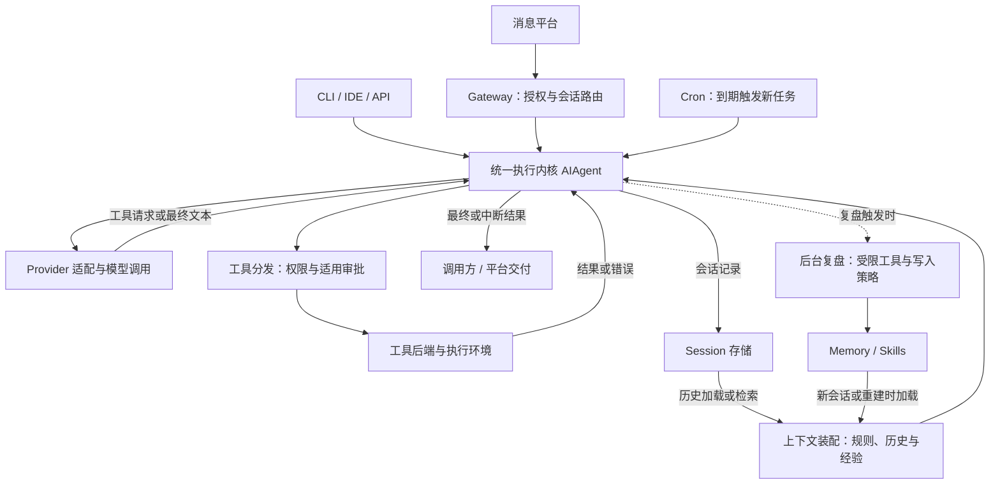

一个 Agent 能完成一次任务，并不意味着它适合每天使用。换一个入口，它是否还记得之前的工作？积累的方法能否复用？执行中断后，哪些结果还能找回？

Nous Research 的 **Hermes Agent** 围绕这些问题，把模型调用、工具执行、消息入口、会话存储和经验更新连接起来。它最有价值的设计，是让任务留下可复用的经验；最需要警惕的代价，则是经验可能出错，而持续在线也不意味着任务可以可靠地断点续跑。

本文分析官方仓库的[固定提交 `2ed6387`](https://github.com/NousResearch/hermes-agent/tree/2ed6387d87b4db091af2f05db32faab6e0dbb9a2)，核对日期为 2026-09-20。以下是文档与源码分析，未运行 Hermes、真实模型或业务服务；文中的周报和工单案例均为假设场景。

## 一、先看整体：任务循环之外，还有经验循环

设想你让 Hermes 每周整理项目进展。第一次，它需要找到资料、理解格式、调用工具生成周报；第二次，你希望它记住资料位置和写作偏好，却又不能照搬上周已经过时的结论。

这要求系统同时处理两条路径：**当前任务如何完成，以及哪些经验值得带到下一次。**

实线描述主要执行与数据路径，虚线表示条件触发的复盘。CLI 等入口直接进入内核；消息平台还需经过 Gateway。工具结果返回模型循环，Memory 与 Skills 则影响后续上下文。图是本文按职责整理的概览，不表示每轮都会执行所有步骤，也不表示一次存储或交付具备跨系统事务保证。[官方架构说明](https://github.com/NousResearch/hermes-agent/blob/2ed6387d87b4db091af2f05db32faab6e0dbb9a2/website/docs/developer-guide/architecture.md)

理解 Hermes 的优缺点，关键就在这两条路径的交界处：它把使用历史变成了产品能力，也把状态管理和经验治理变成了长期责任。

## 二、统一内核：复用执行能力，也集中兼容性负担

不同入口最终复用 `AIAgent`：装配提示词，调用模型，解析工具请求，执行工具，再把结果交回模型，直到生成最终回答或触及运行限制。

当前版本的 `run_agent.py` 已是门面层，主要循环位于 `agent/conversation_loop.py`，各阶段拆入 `agent/turn_*.py`。因此，用“一个巨大脚本包办所有事情”评价当前 Hermes 已不准确；但模块拆分之后，提示词、Provider、工具、重试和会话历史仍须共同遵守同一套运行约定。[Agent Loop 文档](https://github.com/NousResearch/hermes-agent/blob/2ed6387d87b4db091af2f05db32faab6e0dbb9a2/website/docs/developer-guide/agent-loop.md)

**优点是，能力改进可以跨入口复用。** 修正工具结果的回填逻辑，CLI 和消息平台都能受益；更换模型，也不必重写整套工具循环。工具注册表集中保存 Schema、处理函数、工具分组和可用性检查，扩展能力有相对明确的接入点。[工具注册表源码](https://github.com/NousResearch/hermes-agent/blob/2ed6387d87b4db091af2f05db32faab6e0dbb9a2/tools/registry.py)

**代价是，统一接口背后仍有协议差异。** OpenAI-compatible Chat Completions、Responses 和 Anthropic Messages 在工具调用、推理信息、流式响应及缓存上并不完全相同。内部消息表示可以统一，适配代码与回归验证不能省略。一个模型能接通，只证明请求路径可用，不能据此推断复杂工具任务的效果相同。

这里还有一个容易忽略的边界：运行时可以同时执行多个工具请求，再按原顺序回填结果，但**回填顺序不会替你保证副作用顺序**。查询不同网页可以并行；两个工具同时修改同一文件，仍可能冲突。统一执行内核提供调度机制，业务依赖仍需要明确表达。

我的判断是：这一设计很适合需要多入口、多模型的完整助手。如果只是一个固定模型、少量工具的窄任务，维护整套适配和生命周期机制，未必比一个小型显式循环划算。

## 三、上下文分层：降低重复负担，接受可见性的延迟

Hermes 没有把所有历史一直塞进提示词，而是按用途保存信息。

| 信息 | 主要载体 | 解决的问题 | 付出的代价 |
| --- | --- | --- | --- |
| 正在做什么 | 当前对话 | 保留当前目标和工具反馈 | 上下文增长后需要压缩 |
| 过去发生过什么 | SQLite 会话库与全文检索 | 找回原始过程和证据 | 需要选对检索词与会话 |
| 应长期记住什么 | `MEMORY.md`、`USER.md` | 保存短事实和偏好 | 占用提示词，错误可能反复生效 |
| 这类任务怎么做 | Skills | 按需复用操作方法 | 需要正确选择、更新和验证 |

SQLite 与 FTS5 让会话保存和检索可以在本地完成，减少基础设施依赖。容量受限的 Memory 与按需读取的 Skills，又让长期经验不必全部成为每次调用的输入。[会话存储](https://github.com/NousResearch/hermes-agent/blob/2ed6387d87b4db091af2f05db32faab6e0dbb9a2/website/docs/developer-guide/session-storage.md)、[Skills 文档](https://github.com/NousResearch/hermes-agent/blob/2ed6387d87b4db091af2f05db32faab6e0dbb9a2/website/docs/user-guide/features/skills.md)

提示词本身也按稳定性排列：相对稳定的身份和指导在前，项目上下文居中，Skills 索引、记忆快照等易变内容靠后。这里说的是动态 Skills 索引；配置为自动加载的固定 Skill 内容，可以进入稳定前缀。[提示词源码](https://github.com/NousResearch/hermes-agent/blob/2ed6387d87b4db091af2f05db32faab6e0dbb9a2/agent/system_prompt.py)

**优点是，信息生命周期与缓存策略能够配合。** 稳定前缀更有机会被复用，只有遇到相关任务才展开长 Skill。实际缓存命中仍取决于 Provider 和请求内容，不能从分层结构直接推出节省比例。

**代价是，“已经写入”与“当前可见”不再是一回事。** 内置 Memory 会在会话开始时形成快照。新记忆可以立即写到磁盘，工具响应也能展示实时内容，但已缓存的系统提示词通常要在新会话或重建路径中更新。[Memory 文档](https://github.com/NousResearch/hermes-agent/blob/2ed6387d87b4db091af2f05db32faab6e0dbb9a2/website/docs/user-guide/features/memory.md)

回到周报例子：你把输出目录从 A 改成 B，长期记忆已经保存 B，也不能假定当前提示词中的 A 自动消失。当前任务应明确使用 B，并检查实际写入位置。对长期不重置的聊天会话，这种时效差异尤其值得注意。

此外，全文检索保留了找回证据的能力，却不保证模型每次都会查证；摘要压缩减少输入，也可能损失约束。这些都是设计取舍，不能用“拥有长期记忆”一句话略过。

## 四、经验写回：可检查、可修改，也可能持续放大错误

Hermes 的“自我改进”主要通过外部文件和记录实现：后台复盘读取任务过程，判断哪些事实或方法值得保留，再通过 Memory 或 Skill 管理工具更新它们，供未来任务使用。这条路径不需要修改模型权重。

固定版本的后台复盘会在**工具分发阶段**限制可调用能力。基本范围包括 Skills、按触发条件开放的 Memory，以及只读文件工具；配置也可以显式增加部分父任务工具。为复用提示缓存，模型看到的工具定义可以与父任务保持一致，因此真正的约束必须落在执行端。[后台复盘源码](https://github.com/NousResearch/hermes-agent/blob/2ed6387d87b4db091af2f05db32faab6e0dbb9a2/agent/background_review.py)

**优点是，经验成为可检查的对象。** 周报整理方法可以写成 Skill；错误方法可以被人阅读、修正或删除。相比只保留一段难以追溯的对话摘要，这种形式更利于持续维护。

**缺点是，模型总结的经验仍然可能错误。** 假如某次接口超时，复盘将其概括成“该接口不可用，以后改用另一条路径”，一次临时故障就可能变成长期规则。方法越容易复用，错误也越容易复用。

Hermes 已有针对性约束：复盘提示明确排除已解决的瞬态错误，并限制对用户拥有、安装自 Hub 或被固定的 Skills 进行自主修改。Memory 与 Skill 写入还可以开启审批，先暂存，再由人审核；固定版本中，这两项写入审批默认关闭。这些机制降低了错误写入的风险，却不能证明留下来的方法一定正确。[Skills 写入策略](https://github.com/NousResearch/hermes-agent/blob/2ed6387d87b4db091af2f05db32faab6e0dbb9a2/website/docs/user-guide/features/skills.md)

复盘也有成本。它可能重新读取较长的任务过程，并多次调用模型；官方提供了独立模型路由、输入 Token 预算和关闭自动复盘等选项。因此，经验积累是否值得，应看它在后续任务中带来的收益，而不是新增了多少 Skill。

一个可行的验收办法，是用同类但不同内容的任务检查新方法：是否保持准确、是否减少重复纠正、过时后能否被修订。本文没有执行这组实验，所以结论只到“形成了经验更新机制”，不延伸到“已经证明越用越强”。

## 五、常驻服务：能接续对话，不等于能接续所有动作

Gateway 承担授权、会话路由、运行中消息处理、控制命令和结果交付；Cron 则在到期时触发新的 Agent 运行。这些能力让 Hermes 能在消息平台中持续提供服务，而不只存在于一个打开的终端窗口里。[Gateway 文档](https://github.com/NousResearch/hermes-agent/blob/2ed6387d87b4db091af2f05db32faab6e0dbb9a2/website/docs/developer-guide/gateway-internals.md)

**优点是，使用连续性得到了系统支持。** 用户可以停止任务、补充方向、检索历史，也可以让定时任务把结果送回指定入口。把这些问题集中处理，明显优于每个渠道各写一个独立循环。

**代价是，状态种类和故障窗口增多了。** 一次任务至少存在“模型正在运行”“工具已经执行”“结果已经保存”“平台已经收到”等不同状态。任何两个状态之间都可能发生崩溃。

Hermes 对后台子任务给出了很具体的边界：已完成但尚未交付的结果可以在重启后重新投递；进程消失时仍在运行的子任务会标为 `unknown`，因为系统无法证明此前的副作用。这是诚实的恢复语义，而不是实现缺陷的委婉说法。[子任务生命周期](https://github.com/NousResearch/hermes-agent/blob/2ed6387d87b4db091af2f05db32faab6e0dbb9a2/website/docs/user-guide/features/delegation.md)

假设一个子任务已在外部系统创建工单，但来不及保存工单编号就崩溃。会话历史能恢复，不代表系统知道工单是否存在；直接重跑可能创建重复工单。定时重试、后台进程和结果投递记录，各自解决一部分问题，不能自动补齐这段不确定性。

需要可靠处理外部副作用时，工具服务还应提供操作编号、幂等键和状态查询；涉及多步业务时，还要定义补偿或人工对账路径。这是从故障窗口推导出的接入要求，不是说给 Hermes 加一个数据库就能获得事务保证。

本地 SQLite 同样是一项明确取舍：部署与备份方便，但不能仅凭它就推断跨主机高可用或多人租户隔离成立。对于个人助手，简单状态栈很有吸引力；对于共享生产服务，运行、身份、数据和恢复边界都需要重新验收。

## 六、执行权限：防误操作与限制影响范围要同时成立

Hermes 提供危险命令审批、文件路径保护、内容扫描，以及本地、容器和远程执行后端。它的优点是承认不同动作需要不同限制，操作者可以按任务调整自主程度。

但这些机制的作用范围不同。官方安全文档明确指出：`write_file`、`patch` 的路径保护，并不能全面约束以同一系统用户运行的 `terminal`；终端仍可能通过 Shell 访问或覆盖那些路径。[安全边界说明](https://github.com/NousResearch/hermes-agent/blob/2ed6387d87b4db091af2f05db32faab6e0dbb9a2/website/docs/user-guide/security.md)

因此，审批更擅长减少可识别的误操作，内容扫描更擅长发现已知可疑模式。真正限制文件、网络和凭证影响范围，还要依赖执行环境的权限、挂载、出口和密钥配置。选择了 Docker，也仍需检查容器实际得到了什么权限。

Skills 又让这里多了一层责任：系统既能执行方法，也能修改未来要执行的方法。对需要审核的业务，Memory 和 Skill 写入应像配置变更一样接受审查；仅审核某一次终端命令，还没有覆盖未来行为的变化。

将这些取舍放在一起，Hermes 的适用范围就比较清楚了：

| 使用场景 | 架构带来的价值 | 主要验收点 |
| --- | --- | --- |
| 个人研究、资料整理、重复性周报 | 跨会话经验与多入口协作 | 记忆时效、来源与复盘成本 |
| 可信小团队内部助手 | 复用内核、工具和渠道能力 | 用户之间的工具、文件和记忆边界 |
| 固定流程、极少工具的单一任务 | 部分运行机制可复用 | 完整服务栈是否带来多余维护负担 |
| 不可重复执行的业务动作 | 可承担理解、规划与交互 | 后端幂等、审批、结果查询与对账 |

**我对 Hermes 的总体评价是：它为长期个人助手做出了一组连贯的选择，但这些选择需要持续治理。** 统一内核减少重复实现，上下文分层控制输入，Memory 和 Skills 让经验可复用，Gateway 让服务持续可达；相应的代价是兼容性维护、记忆可见性延迟、经验污染，以及多种状态之间的恢复责任。

判断是否采用 Hermes，最有效的问题是：你的任务是否会反复出现，经验是否真的能帮助下一次，以及当记错、做错或中断时，系统能否把问题暴露出来并纠正。需要继续比较执行与恢复机制，可以阅读 [Agent Runtime 选型](/writing/agent-runtime-selection/)；关注编码场景，则可参考 [Coding Agent 比较](/writing/coding-agent-harness-showdown/)。
