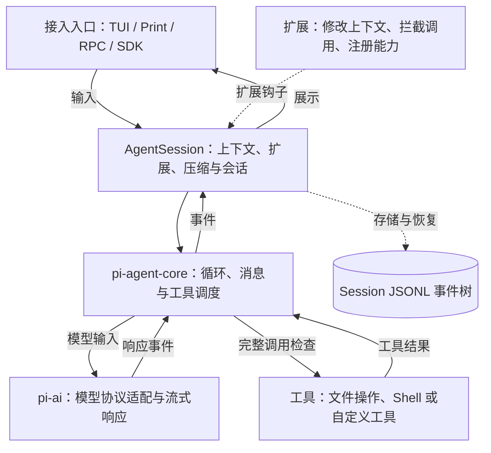

一个 Coding Agent 应该内置多少能力？计划、子 Agent、工具协议、权限审批，每增加一项，默认工作流就更完整，也更难重新组合。Pi 的选择是保留少量默认工具，把许多工作流交给扩展。

**Pi 最值得借鉴的是职责边界：模型适配、执行循环、会话管理和交互界面可以分别变化。它最大的代价，则是这些边界之外的工作不会消失，而要由使用者和集成团队接手。** 因此，评价 Pi 不能只数工具和代码行，还要看完成同一个任务需要谁补上什么。

本文讨论 Mario Zechner 发起的 Pi coding agent，原仓库地址为 `badlogic/pi-mono`，现为 `earendil-works/pi`。分析固定于 [`19451ac`](https://github.com/earendil-works/pi/tree/19451accdeec671c1f4da9eafac8fc270f510ef4)，其 coding-agent 包版本为 `0.86.1`。依据是官方文档与选定源码，未运行 Pi、模型调用或性能实验；下文案例均为说明取舍的假设场景。

## 1. 小的是默认工作流，不是整个系统

Pi 默认给模型四个工具：`read`、`write`、`edit` 和 `bash`。读写修改构成代码操作基础，Shell 则复用搜索、测试、构建等现有工具链。`grep`、`find`、`ls` 等工具也存在，只是不属于这组默认配置；计划模式和子 Agent 等功能可由扩展实现。[工具定义](https://github.com/earendil-works/pi/blob/19451accdeec671c1f4da9eafac8fc270f510ef4/packages/coding-agent/src/core/tools/index.ts)、[产品说明](https://github.com/earendil-works/pi/blob/19451accdeec671c1f4da9eafac8fc270f510ef4/packages/coding-agent/README.md)

这一选择减少了默认工具接口和产品约定，开发者可以沿用熟悉的命令，定制工作流也不必先拆掉一整套预设。但成本随之移到了命令组织、环境依赖和结果理解上：一个结构化测试工具可以明确返回失败用例；通过 `bash` 跑测试，往往需要模型从文本中提取信息。

更容易被忽略的是，**工具少不代表权限小**。一个能调用 Shell 的工具，就可能启动进程、访问网络或运行脚本。接口数量、执行能力和安全边界是三件不同的事。

沿着一次请求，Pi 的主要职责可以这样理解：

图中实线表示主要调用与返回关系，虚线表示会话存储和扩展协作。模型响应可能包含文本、工具请求或错误；循环处理工具结果后，可以再发起下一轮模型调用。运行结束仍需区分完成、失败和取消，也不自动等于用户目标已验收。这里描述默认 `Agent + AgentSession` 路径，不把实验性多进程方案画进来。[会话装配源码](https://github.com/earendil-works/pi/blob/19451accdeec671c1f4da9eafac8fc270f510ef4/packages/coding-agent/src/core/sdk.ts)

## 2. 分层的收益是可替换，代价是协调工作集中

Pi 把模型协议交给 `pi-ai`，把通用循环交给 `pi-agent-core`，把编程场景中的资源、会话和扩展交给 `pi-coding-agent`，再由不同入口呈现结果。

这个分法有两个实质好处。首先，Provider 与 API 协议分开：模型所属的服务提供方，不必与某一种线协议绑定。上层消费统一消息和流事件，无须把每个厂商的调用细节写进循环。[Provider 接口](https://github.com/earendil-works/pi/blob/19451accdeec671c1f4da9eafac8fc270f510ef4/packages/ai/src/models.ts)

其次，内部消息与模型输入分开。每轮先允许 `transformContext` 调整上下文，再经 `convertToLlm` 转换为模型消息。这让应用保存自己的事件、界面信息和扩展状态，而不必把它们全部塞进模型请求。[输入转换源码](https://github.com/earendil-works/pi/blob/19451accdeec671c1f4da9eafac8fc270f510ef4/packages/agent/src/agent-loop.ts#L339-L355)

假设要把 Pi 嵌入一个代码评审工具，集成方可以复用会话与循环，换掉终端入口，并按需注入评审上下文。这个扩展点明确，是架构上的优点。

但“能换模型”不代表模型行为等价。推理内容、工具格式、缓存和停止原因仍有差异，适配层必须持续维护；模型切换后的任务效果也需要重新验证。统一接口减少了调用方的分支，没有消除协议差异。[模型与事件类型](https://github.com/earendil-works/pi/blob/19451accdeec671c1f4da9eafac8fc270f510ef4/packages/ai/src/types.ts)

分层还把大量协调工作集中到了 `AgentSession`：扩展、重试、压缩、模型切换、工具集合和会话记录都在这里交汇。该文件在本文快照中有 3699 行。行数不能证明设计有问题，却提醒我们：底层循环简洁，上层产品状态仍然复杂。维护难点是压缩、取消和扩展重载同时发生时，状态能否一致。[AgentSession 源码](https://github.com/earendil-works/pi/blob/19451accdeec671c1f4da9eafac8fc270f510ef4/packages/coding-agent/src/core/agent-session.ts)

## 3. 循环清晰，但并发与纠偏都有边界

Pi 的基本执行路径很直白：准备输入，请求模型，执行工具，把结果放回上下文，再决定是否继续。真正体现设计质量的是其中的时序约束。

在这个快照中，`Agent` 默认允许并行工具执行。同一批请求按顺序预检，通过的工具并发运行；完成事件可以按实际完成顺序出现，但结果消息按原调用顺序进入上下文。如果其中一个工具声明 `executionMode: "sequential"`，整批转为串行。[默认配置](https://github.com/earendil-works/pi/blob/19451accdeec671c1f4da9eafac8fc270f510ef4/packages/agent/src/agent.ts#L235-L253)、[工具批次实现](https://github.com/earendil-works/pi/blob/19451accdeec671c1f4da9eafac8fc270f510ef4/packages/agent/src/agent-loop.ts#L464-L619)

对互不依赖的读取，这提供了并发机会，也让展示顺序与模型上下文顺序各自有明确规则。但它没有自动推断业务依赖：两个工具都改同一个文件，结果排列再稳定，也不能消除写入竞争。自定义工具的作者仍要声明执行约束，或把有依赖的动作拆到不同轮次。

用户中途追加要求时，Pi 区分 **steering** 和 **follow-up**：前者在当前工具批次结束后的边界进入后续推理，后者等当前循环原本准备结束时再处理。这比把所有输入放进同一个队列更容易理解，但 steering 不能撤销已经运行的命令。[队列语义](https://github.com/earendil-works/pi/blob/19451accdeec671c1f4da9eafac8fc270f510ef4/packages/agent/README.md)

例如，Agent 已开始执行迁移脚本，用户才说“只检查，不修改”。这条输入可以影响后续行动，却不能让先前写入自动消失。需要严格“先审批再执行”的操作，应在调用前设门禁，不能依赖用户及时补一句话。

循环也明确处理异常：模型响应为错误或取消时退出；输出被长度上限截断且包含工具请求时，不执行可能残缺的参数，而是生成失败结果。这些是源码可确认的控制规则，不代表外部工具具备事务或回滚能力。[响应分支](https://github.com/earendil-works/pi/blob/19451accdeec671c1f4da9eafac8fc270f510ef4/packages/agent/src/agent-loop.ts#L217-L284)

## 4. 会话树方便探索，但恢复对话不等于恢复世界

Pi 用 JSONL 保存会话，条目通过 `id` 和 `parentId` 形成树。选择过去的节点继续，就能形成另一条分支；构建模型上下文时，则沿当前叶节点回溯，并处理压缩等条目。[Session 格式](https://github.com/earendil-works/pi/blob/19451accdeec671c1f4da9eafac8fc270f510ef4/packages/coding-agent/docs/session-format.md)

这很适合编程中的探索：先试重构方案 A，再回到讨论起点试方案 B，两段推理历史都能留下。相比不断覆盖聊天记录，事件树让过程更容易查阅和解释。

但会话分支并不默认分叉工作目录。假设 A 已修改 `parser.ts`，切回旧节点并不会顺带恢复旧文件。要隔离两套方案，需要另外组合 Git checkpoint、worktree 或文件快照。**对话状态、文件状态和外部服务状态必须分别管理。**

Compaction 也遵循这种分离：旧记录保留，新增摘要与保留边界；下一轮模型读到的是摘要加近期消息。它控制了上下文规模，并保留回查条件，但摘要有损，完整历史还在磁盘上不代表模型此刻能看到它。[压缩机制](https://github.com/earendil-works/pi/blob/19451accdeec671c1f4da9eafac8fc270f510ef4/packages/coding-agent/docs/compaction.md)

因此，关键约束适合放入可重新读取的项目文件或结构化任务状态。比如“必须兼容旧版数据格式”，不能只期待它在多次摘要后始终完整保留。这是集成建议，不是 Pi 默认自动完成的保障。

同样，JSONL 记录不能单独保证外部动作只发生一次。假设工具已成功创建工单，进程却在保存结果前退出，重启后的系统必须先查询业务操作状态，再决定是否重试。会话恢复提供历史，幂等键、结果核对与补偿才负责外部副作用。这类事故恢复能力需要单独验收，不能从“支持恢复会话”直接推导。[SessionManager 实现](https://github.com/earendil-works/pi/blob/19451accdeec671c1f4da9eafac8fc270f510ef4/packages/coding-agent/src/core/session-manager.ts)

## 5. 扩展提高自由度，也把治理责任交给集成方

Pi 扩展可以注册工具和命令，修改模型上下文，拦截 `tool_call`，改写 `tool_result`，定制压缩和界面。团队可以把“计划阶段只读”“运行前确认”“接入内部知识”等策略放进扩展，减少直接修改 Pi 内部实现的需要。[扩展接口](https://github.com/earendil-works/pi/blob/19451accdeec671c1f4da9eafac8fc270f510ef4/packages/coding-agent/docs/extensions.md)

自由度的另一面是组合成本。一个扩展裁剪上下文，另一个注入规范，第三个改写工具输出，最后模型看到什么就取决于它们的处理顺序。`ExtensionRunner` 的上下文处理会把前一个处理器产出的消息继续交给后一个；单独正确的扩展，组合后也需要验证。[扩展执行源码](https://github.com/earendil-works/pi/blob/19451accdeec671c1f4da9eafac8fc270f510ef4/packages/coding-agent/src/core/extensions/runner.ts#L1085-L1110)

更重要的是，扩展是进程内受信代码，拥有 Pi 进程的文件、网络等访问能力。通过工具钩子加确认，可以形成工作流约束，却不能隔离恶意扩展：它自己就能调用 Node.js 能力。

Pi 的 Project Trust 负责决定是否加载项目本地设置、资源、包和扩展；它不是执行沙箱。上下文文件如 `AGENTS.md` 也不能简单理解为“拒绝信任后全部不读”。官方明确说明，工具默认继承启动用户的权限，真正隔离需要操作系统或容器边界。[安全模型](https://github.com/earendil-works/pi/blob/19451accdeec671c1f4da9eafac8fc270f510ef4/packages/coding-agent/docs/security.md)

这让熟悉本机环境的开发者拥有直接、可组合的工具。若要运行不可信仓库或无人值守任务，集成方则需要选择隔离环境、约束凭证和网络，并明确审批与审计规则。官方提供整进程容器化、工具路由到微型虚拟机等不同方案；选哪一种，要看需要保护的是哪些资源。[隔离指南](https://github.com/earendil-works/pi/blob/19451accdeec671c1f4da9eafac8fc270f510ef4/packages/coding-agent/docs/containerization.md)

## 6. 怎样判断 Pi 是否适合自己的系统

把前面的机制放在一起，Pi 的优缺点其实来自同一组选择：

| 架构选择 | 直接收益 | 需要承担的代价 |
| --- | --- | --- |
| 少量默认工具，复用 Shell | 接口集中，沿用开发工具链 | 命令与环境依赖多，权限范围仍大 |
| 模型、循环、会话与入口分层 | 便于换入口、嵌入与定制 | 协议适配与会话协调持续复杂 |
| 工具批次并发、结果有序 | 独立调用可重叠执行，上下文顺序明确 | 副作用依赖需要显式管理 |
| 会话事件树与摘要投影 | 便于分支、回查和长对话 | 不提供文件回滚或无损记忆 |
| 强扩展，隔离外置 | 产品策略可以自行组合 | 扩展兼容、信任和治理需另行建设 |

对愿意定制的个人开发者，或已有沙箱、任务服务和审计基础设施的团队，Pi 是值得评估的执行与会话组件。它把很多选择留在可编程接口上，适合需要拥有工作流控制权的人。

如果目标是开箱即用的团队标准流程，或者包含强审批、多租户隔离、长任务故障恢复的服务，那么评估重点应是**补齐这些能力后的总成本**。能通过扩展实现，不等于部署后天然具备；接口清晰，也不能替代端到端验收。这是基于职责分配的判断，不是性能排名。

还要防止把仓库里的新路线当成默认能力。在本文快照中，`pi-durable` 的公开导出是记录类型、存储契约和 `MemoryStorage` 等，README 指向 Pico 设计与实现计划；默认会话装配仍创建 `Agent` 和 `AgentSession`。仅凭 durable 包名或设计文档，不能宣称默认 CLI 已具备跨进程持久执行保障。旧版本中的实验性 `AgentHarness`、client/server 研究也不宜未经核对直接套用到新版。[durable 说明](https://github.com/earendil-works/pi/blob/19451accdeec671c1f4da9eafac8fc270f510ef4/packages/durable/README.md)、[实际导出](https://github.com/earendil-works/pi/blob/19451accdeec671c1f4da9eafac8fc270f510ef4/packages/durable/src/index.ts)

我的判断是：**Pi 的价值在于把核心职责组织成可理解、可替换的部件；它的使用门槛，在于你要清楚哪些责任还属于自己。** 小内核确实能减少一部分耦合，但安全、状态一致性和任务验收，最终仍要在完整系统中得到回答。

## 参考与延伸

本文链接均以固定提交为源码依据；机制说明与适用性推断已分开表达。源码索引、文件哈希及站点检查记录保存在项目的 `docs/pi-architecture-study/`，不包含模型或真实 Agent 实验结果。

- [Pi 官方仓库：本文快照](https://github.com/earendil-works/pi/tree/19451accdeec671c1f4da9eafac8fc270f510ef4)
- [SDK 接入文档](https://github.com/earendil-works/pi/blob/19451accdeec671c1f4da9eafac8fc270f510ef4/packages/coding-agent/docs/sdk.md)
- [Agent Runtime：执行、状态与恢复的职责](/writing/agent-runtime/)
- [Agent Runtime 技术选型](/writing/agent-runtime-selection/)
- [Coding Agent Harness 对照](/writing/coding-agent-harness-showdown/)
